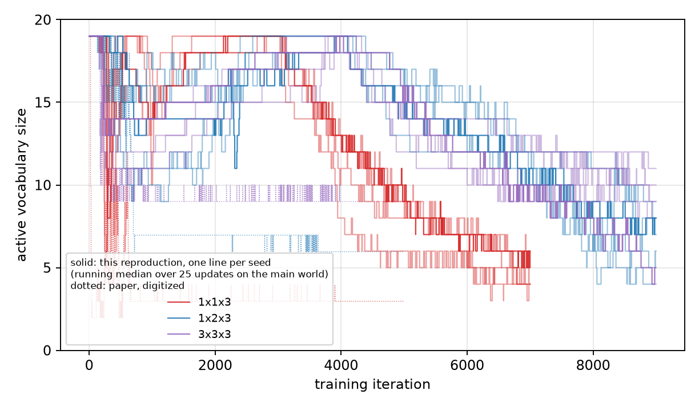

# Emergence of Grounded Compositional Language: a PyTorch reproduction

An independent, unofficial reproduction of

> Igor Mordatch and Pieter Abbeel. **Emergence of Grounded Compositional Language in Multi-Agent Populations.** AAAI 2018. [arXiv:1703.04908](https://arxiv.org/abs/1703.04908)

Agents in a differentiable 2-D particle world each hold a private goal that another agent must carry out, and can emit one discrete symbol per step. Trained end to end through the episode, they invent a language. This repository implements the environment, the policy and the training procedure from the paper's description, reproduces its experiments with multiple seeds, and reports what does and does not replicate.



## What reproduces

Five seeds per world, 10,000 held-out test worlds per run, exact discrete symbols at test time.

| World (agents × action types × landmarks) | Test reward, no communication | Test reward, communication | Addressee ends at the instructed landmark |
|---|---:|---:|---:|
| 1x1x3 | −0.597 | −0.360 ± 0.033 | 82% (33% without messages) |
| 1x2x3 | −0.534 | −0.297 ± 0.024 | 75% (33%) |
| 3x3x3 | −0.363 | −0.203 ± 0.019 | 65% (34%) |

| Paper claim | Status |
|---|---|
| Agents that can talk outperform agents that cannot (Table 1) | Reproduced on 15 of 15 seeds |
| Words for actions and for agents | Reproduced in the three-agent world |
| Words for landmark colours | **Not reproduced.** Landmarks are referred to by position relative to one reference landmark, and silence is used as a signal |
| Vocabulary sizes 3 / 6 / 9 (Figure 6) | 4.8 / 7.0 / 9.2 at the end of training, but set by the penalty weight; the vocabulary penalty had to be delayed |
| GOTO is uttered first | Not reproduced; the action word comes last |
| Generalization to extra agents, extra landmarks, conflicting goals | Partly |
| Non-verbal strategies: pointing, guiding | Reproduced |
| Non-verbal strategy: pushing | Only with a softened contact force |

The full account, claim by claim, with ablations and a list of what was not reproduced, is in [`docs/RESULTS.md`](docs/RESULTS.md). Per-seed tables and figures are in [`report/results.md`](report/results.md).

Three findings go beyond the paper:

- **Positional reference.** Because agents' private frames differ only by rotation, "the landmark nearer to the red one" is shared knowledge. Every run exploited this and never bound three words to three colours.
- **The vocabulary penalty trades test accuracy for a small vocabulary.** Training uses relaxed symbols, which carry graded information; shrinking the vocabulary costs nothing there and up to 0.18 in end-of-episode reward with exact symbols.
- **What makes language emerge at all.** The paper's literal auxiliary task (predict the speaker's goal as the speaker holds it) and a delayed vocabulary penalty are both necessary; initialisation decides how long it takes. See [`docs/REVIEW.md`](docs/REVIEW.md).

## Installation

Python 3.10 or later.

```sh
git clone https://github.com/zichuanxu/emergent-language.git
cd emergent-language
python -m venv .venv && source .venv/bin/activate
pip install -e ".[dev]"
python -m pytest tests -q        # 51 tests, under a minute on CPU
```

## Quick start

```sh
# Can the speaker and the listener halves learn their parts at all? (two minutes on CPU)
python -m emlang.probe speaker --init he
python -m emlang.probe listener --init he

# Train two seeds of the two-agent world (GPU recommended; add --device cuda)
python -m emlang.train --case 1x1x3 --run-dir runs/demo --seed 1,2 --names s1,s2 \
    --init he --horizon 6 --aux-frame speaker --w-goal 0.1 \
    --w-vocab 0.05 --w-utter 0.02 --penalty-start 3000 --penalty-ramp 1000 --iters 7000

# Evaluate on held-out worlds against a no-communication baseline you trained with --no-comm
python -m emlang.evaluate runs/demo/s1 --baseline runs/demo_nocomm/s1
```

Training checkpoints every 250 updates, stops cleanly on SIGTERM and resumes when the same command is run again.

## Reproducing the reported runs

The exact command line of every reported run is in [`experiments/`](experiments): `suite_main.txt` (15 communicating seeds, 9 baseline seeds), `suite_nonverbal.txt` (9 seeds) and `suite_ablations.txt` (24 seeds). Each line is one process that trains several seeds at once. On a single 40 GB GPU with the lines running concurrently, everything takes four to five hours.

```sh
# 1. train: run each line of the job lists (scripts/cluster/ has launchers for a Docker GPU server)
# 2. evaluate every run on 10,000 held-out worlds
bash scripts/evaluate_all.sh main && bash scripts/evaluate_all.sh ablations
# 3. tables and Figures 4-7
python -m emlang.report --runs runs/main --out report --ablations runs/ablations
```

The repository contains each reported run's configuration, per-update metrics, evaluation and sampled test episodes under [`runs/`](runs), so step 3 works on a fresh clone.

### Trained models

The trained and initial weights of all 57 reported seeds are attached to the [v1.0.0 release](https://github.com/zichuanxu/emergent-language/releases/tag/v1.0.0) (258 MB in two archives). Extracted at the repository root they land next to each run's results, which lets step 2 and the `analysis/` scripts run without training:

```sh
gh release download v1.0.0 --repo zichuanxu/emergent-language
shasum -a 256 -c SHA256SUMS.txt
tar -xzf emlang-checkpoints-main.tar.gz && tar -xzf emlang-checkpoints-ablations.tar.gz

# re-evaluate one run; the output matches the committed runs/main/1x1x3_comm/s1/eval.json
python -m emlang.evaluate runs/main/1x1x3_comm/s1 --baseline runs/main/1x1x3_nocomm/s1 --out /tmp/eval_s1
```

## Repository layout

| Path | Contents |
|---|---|
| `emlang/world.py` | Batched differentiable particle world: dynamics, private frames, goals, reward, contact |
| `emlang/policy.py` | The paper's Figure 3 policy with Gumbel-Softmax utterances |
| `emlang/train.py` | Backpropagation through whole episodes, auxiliary goal prediction, vocabulary reward, several seeds per process |
| `emlang/evaluate.py` | Held-out evaluation: rewards, word meanings, generalization and non-verbal probes |
| `emlang/report.py` | Table 1, Figures 4–7 and per-claim tables from evaluated runs |
| `emlang/probe.py` | Learnability probes for the speaker and listener halves |
| `tests/` | 51 tests, including evaluation statistics checked on synthetic languages with known answers |
| `experiments/` | Job lists of the reported runs |
| `scripts/` | Batch evaluation; launch, queue and sync scripts for a GPU server |
| `analysis/` | Small analyses quoted in the results |
| `runs/`, `report/` | Results of the reported runs; generated tables and figures |
| `docs/` | [`RESULTS.md`](docs/RESULTS.md), [`IMPLEMENTATION.md`](docs/IMPLEMENTATION.md) (every choice the paper leaves open), [`REVIEW.md`](docs/REVIEW.md) (why a first attempt failed and what is still open) |

## Citation

If you use this code, please cite the original paper:

```bibtex
@inproceedings{mordatch2018emergence,
  title     = {Emergence of Grounded Compositional Language in Multi-Agent Populations},
  author    = {Mordatch, Igor and Abbeel, Pieter},
  booktitle = {Proceedings of the AAAI Conference on Artificial Intelligence},
  year      = {2018}
}
```

## License

[MIT](LICENSE). This is not the authors' code; it was written from the paper's text and is not affiliated with them.
