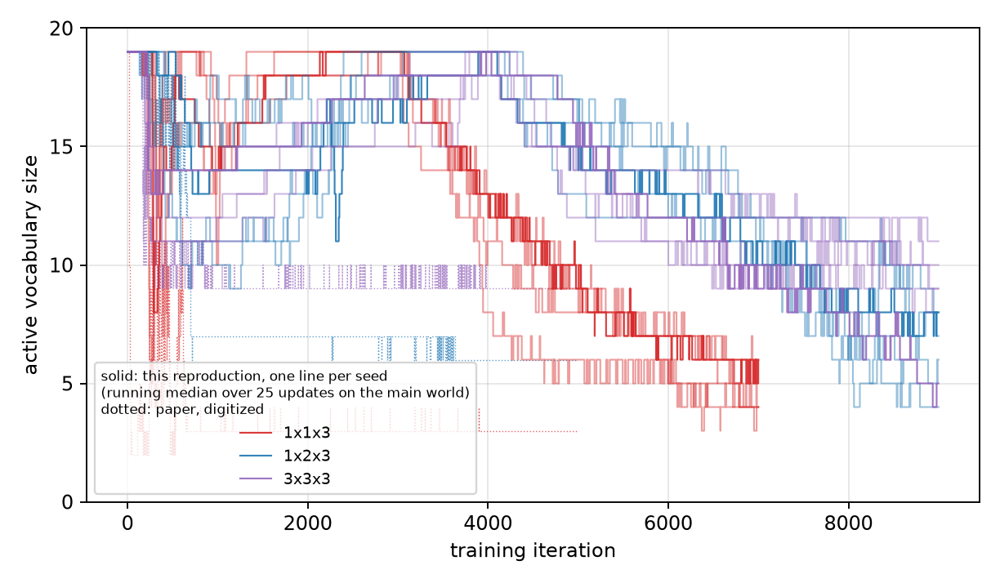
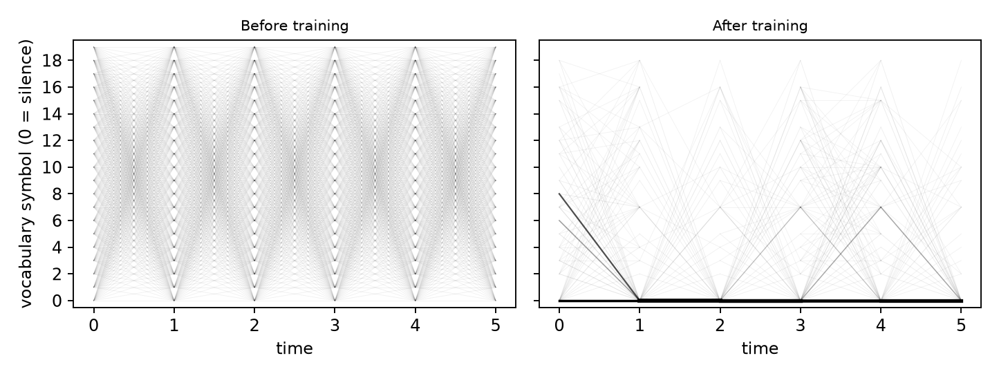
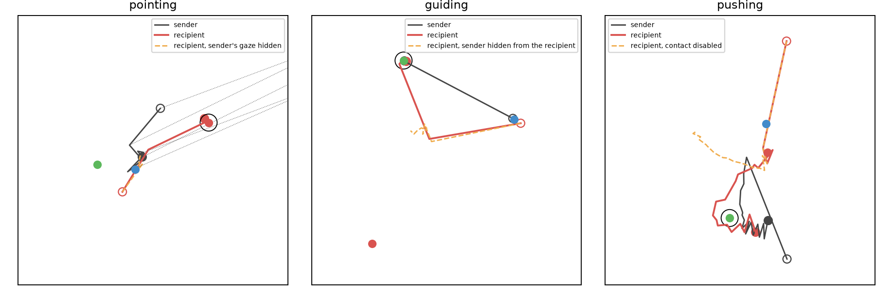

# Results

Paper: Mordatch & Abbeel, *Emergence of Grounded Compositional Language in Multi-Agent Populations* (arXiv:1703.04908v2).

This file states, claim by claim, what the reported runs show. The numbers come from [`report/results.md`](../report/results.md), which `python -m emlang.report` generates from the runs' `eval.json` and `metrics.npz` (per-seed tables, 95% intervals and all symbol tables are there), and, where a section says so, from the scripts in `analysis/`. Choices the paper leaves open are listed in [`IMPLEMENTATION.md`](IMPLEMENTATION.md). Why a first attempt failed, and what a working reproduction needs, is in [`REVIEW.md`](REVIEW.md). Paths are relative to the repository root.

## What was run

| Group | Runs | Job list |
|---|---|---|
| Communication, worlds 1x1x3, 1x2x3, 3x3x3 (agents × action types × landmarks) | 5 seeds each; 7,000 / 9,000 / 9,000 updates | `experiments/suite_main.txt` |
| No-communication baselines, same worlds | 3 seeds each | `experiments/suite_main.txt` |
| Non-verbal worlds: pointing, guiding, pushing | 3 seeds each; 3,000 updates | `experiments/suite_nonverbal.txt` |
| Ablations of 1x1x3 | 2 seeds per variant; 7,000 updates | `experiments/suite_ablations.txt` |

Training follows the paper where it is specific: 1,024 fresh worlds per update, Gumbel-Softmax utterances with τ = 1, backpropagation through the whole episode, vocabulary of 20, the Figure 3 policy. Episodes last 6 steps in the verbal worlds, 10 in pointing and guiding, 20 in pushing. The 1x2x3 and 3x3x3 runs train on a mixture: half of the updates use the full world and half a simpler one (one landmark, fewer action types, or two agents). Evaluation uses 10,000 held-out worlds per run (4,000 for the probes of unseen configurations and for the omission tests of §4), **exact categorical utterances**, and dropout off. "± " is the standard deviation over training seeds.

## Summary

| Paper claim | Status | Evidence |
|---|---|---|
| Agents that can talk outperform agents that cannot (Table 1) | **Reproduced**, 15 of 15 seeds | Test reward −0.360 / −0.297 / −0.203 with messages against −0.597 / −0.534 / −0.363 without. The addressee ends at the instructed landmark in 82% / 75% / 65% of episodes against 33–34% |
| Table 1 values (−0.919 → −0.392) | Not comparable | The paper gives neither the world nor how reward is reduced. One reduction matches its baseline; see §1 |
| The reward depends on the messages | **Reproduced** | Silencing the messages at test time drops reward below the no-communication baseline in every seed |
| Vocabulary shrinks under the vocabulary reward; final sizes 3 / 6 / 9 (Figure 6) | Partly | Sizes at the end of training are 4.8 ± 1.1 / 7.0 ± 2.0 / 9.2 ± 2.6, but they are set by the penalty weight and still falling, and the shrinking costs accuracy with exact symbols. The penalty had to be delayed; applied from the first update it erases the channel |
| Symbols for actions and for agents | **Reproduced** (3x3x3), with gaps | Every seed has action words and addressee-colour words with precision 1.00; action is decodable from an utterance stream at 94%, addressee at 96%. Most seeds leave one action and one colour without a word and signal it by the absence of the others |
| Symbols for landmark colours | **Not reproduced** | Landmarks are referred to by position relative to the other landmarks, with at most one colour named. Colour is decodable from words at 42–60% and at 66–84% once the landmark layout is known |
| Multi-word utterances; with two agents GOTO is uttered first | Partly; the order is **not reproduced** | Utterances combine action, addressee and landmark words (1.5 per stream in 3x3x3). In 1x2x3 the action word comes last, not first. With three agents the paper reports no set order, and none holds across seeds here |
| Words are omitted when context makes them redundant | Partly | With one landmark, landmark words vanish and utterances fall from 1.14 to 0.47 per stream (1x2x3, which saw one-landmark worlds in training). An action word is not dropped when only one action exists, and speakers still talk about goals of their own. Silence itself is used as a code word |
| Generalization to an extra agent, extra landmarks, conflicting goals | Partly | An extra agent in the addressee's colour moves 0.54 towards the target against 0.25 in an unseen colour. A fourth landmark hurts. Under conflicting commands the paper's averaging is not observed |
| Non-verbal strategies: pointing, guiding (Figure 7) | **Reproduced**, with a design choice | Recipient ends 0.03 / 0.02 from the target; 0.62 away when the cue is hidden. In guiding the recipient follows whether or not it is being addressed |
| Non-verbal strategy: pushing | Partly | Learned only with a softened contact force: recipient moved from 1.04 to 0.25 from the target; 0.60 when the same policy is run with the default force |

## 1. Reward with and without communication (Table 1)

Reward is the negative squared goal error, averaged over goals and over the six steps of the episode ("step mean"). Train columns are the mean of the last 200 updates on the main world, with relaxed utterances as in training.

| World | No comm., train | Comm., train | No comm., test | Comm., test | Test gain, paired | Comm. / no comm., test |
|---|---:|---:|---:|---:|---:|---:|
| Paper (world unspecified) | −0.919 | −0.332 | −0.920 | −0.392 | +0.528 | 0.43 |
| 1x1x3 | −0.595 | −0.308 ± 0.001 | −0.597 ± 0.001 | −0.360 ± 0.033 | +0.237 ± 0.034 | 0.60 ± 0.06 |
| 1x2x3 | −0.532 | −0.219 ± 0.007 | −0.534 ± 0.001 | −0.297 ± 0.024 | +0.238 ± 0.025 | 0.56 ± 0.05 |
| 3x3x3 | −0.363 | −0.189 ± 0.019 | −0.363 ± 0.001 | −0.203 ± 0.019 | +0.160 ± 0.019 | 0.56 ± 0.05 |

The smallest per-seed gain is +0.128 [+0.125, +0.132] (3x3x3, seed 1). The three baselines of a world differ by at most 0.003, so the gain is not baseline noise.

The step mean understates the effect: the first scored position does not depend on the policy and the second cannot depend on any message. At the end of the episode:

| World | Terminal reward: no comm. | comm., exact symbols | comm., relaxed symbols | messages silenced | Addressee ends nearest its target landmark: no comm. | comm. | silenced |
|---|---:|---:|---:|---:|---:|---:|---:|
| 1x1x3 | −0.448 | −0.073 ± 0.040 | −0.005 ± 0.002 | −0.636 ± 0.083 | 0.333 | 0.817 ± 0.070 | 0.335 |
| 1x2x3 | −0.459 | −0.114 ± 0.026 | −0.025 ± 0.007 | −0.580 ± 0.011 | 0.333 | 0.745 ± 0.032 | 0.331 |
| 3x3x3 | −0.328 | −0.089 ± 0.022 | −0.060 ± 0.030 | −0.499 ± 0.058 | 0.340 | 0.647 ± 0.098 | 0.335 |

Three things follow.

- **Without messages agents go to the centre of the landmarks**, which is the best guess: they end 0.03 from the centroid in the two-agent worlds. With messages they end 0.53–0.57 from it.
- **Silencing is worse than never having had a channel**, because listeners trained with messages read silence as a message (§3).
- **Exact symbols lose part of what relaxed symbols carry.** Training uses the relaxed Gumbel-Softmax sample, a vector that can carry graded information; a test-time symbol cannot. The gap is 0.07–0.09 in terminal reward in the two-agent worlds, and it is produced by the vocabulary reward (§7): without that reward it is 0.004. The paper reports a small train–test gap (−0.332 against −0.392); here the two-agent gaps on the same scale are 0.05–0.08.

**On the paper's scale.** The paper does not say which world Table 1 uses or how reward is reduced. If reward is read as the end-of-episode error summed over the agents' goals, the no-communication baseline of the 1x2x3 world here is −0.918 ± 0.002 (train −0.912), against the paper's −0.919 / −0.920. It is what going to the landmarks' centroid earns two agents with go-to and look-at goals; the same reduction gives −0.896 in 1x1x3 and −0.984 in 3x3x3. The agreement suggests, but does not prove, that Table 1 is this world under this reduction. On that scale communication gives −0.227 ± 0.051 at test here (paper −0.392) and −0.051 ± 0.014 with relaxed symbols (paper's train value −0.332).

## 2. Vocabulary size (Figure 6)

| World | Paper | Active words at the end of training | per seed | Active words on test (exact symbols) | of which above 1% of utterance slots |
|---|---:|---:|---|---:|---:|
| 1x1x3 | 3 | 4.8 ± 1.1 | 6, 4, 6, 4, 4 | 6.0 ± 1.6 | 3.2 ± 1.1 |
| 1x2x3 | 6 | 7.0 ± 2.0 | 8, 6, 9, 4, 8 | 12.4 ± 0.5 | 5.6 ± 1.5 |
| 3x3x3 | 9 | 9.2 ± 2.6 | 5, 9, 12, 10, 10 | 12.2 ± 1.1 | 5.4 ± 1.1 |

A word is active if it fills at least 0.5% of utterance slots (the paper gives no threshold).

At the end of training the ordering across worlds matches the paper and the sizes are close to it (on test episodes the two larger worlds do not differ). Three qualifications matter more than the match.

1. **The size is set by the penalty weight, not found by the agents.** The counts are still falling in 9 of 15 seeds when training stops (Figure 6), and the ablation in §7 moves the final size from 17.5 to 1 by changing the weight alone.
2. **The timing differs from the paper.** In the paper the vocabulary collapses within the first few hundred updates and then stabilises. Here the vocabulary reward and utterance cost are off until update 3,000 (4,000 in the larger worlds). Applied from the first update, they remove every word before any is useful (§7).
3. **Speakers say more when listeners hear exact symbols.** For 1x2x3 seed 4, the same policy on the same worlds uses 5 words above the 0.5% threshold when messages are relaxed and 13 when they are exact (3 and 5 above 1%; `analysis/relaxed_vs_exact_words.md`, which also shows 3 against 11 for 3x3x3 seed 1). With exact messages listeners err more often and speakers keep talking. Many words sit near the threshold, so the count is sensitive to it.

## 3. What the words mean

### Landmarks are named by position, not by colour

The paper reports one word per landmark colour. No run here produced that. Nine of the ten two-agent runs converged on the same kind of code:

- one landmark colour is the **reference** and has words of its own;
- other words mean "the landmark **farther** from the reference";
- in eight of those nine, **saying nothing** is the usual signal for "the landmark **nearer** to the reference": 58–77% of speakers with that target say nothing. Silence is not a clean word. It also occurs for the reference landmark (10–44%), and in six of the eight runs addressees are least accurate there.

Share of speakers that say nothing about the landmark, and share of addressees that end at the target, by which landmark is the target (`analysis/named_colour_code.md`; go-to goals, 10,000 test worlds per run):

| Run | Reference colour | Target is the reference: says nothing | addressee at target | Target is the nearer other: says nothing | addressee at target | Target is the farther other: says nothing | addressee at target |
|---|---|---:|---:|---:|---:|---:|---:|
| 1x1x3 s1 | green | 0.33 | 0.58 | 0.75 | 0.92 | 0.24 | 0.74 |
| 1x1x3 s2 | blue | 0.00 | 0.98 | 0.44 | 0.86 | 0.45 | 0.93 |
| 1x1x3 s3 | green | 0.27 | 0.64 | 0.74 | 0.87 | 0.21 | 0.76 |
| 1x1x3 s4 | green | 0.14 | 0.80 | 0.76 | 0.91 | 0.20 | 0.79 |
| 1x1x3 s5 | red | 0.10 | 0.83 | 0.77 | 0.91 | 0.22 | 0.73 |
| 1x2x3 s2 | red | 0.35 | 0.49 | 0.71 | 0.83 | 0.20 | 0.78 |
| 1x2x3 s3 | blue | 0.27 | 0.70 | 0.63 | 0.85 | 0.13 | 0.81 |
| 1x2x3 s4 | blue | 0.32 | 0.53 | 0.68 | 0.87 | 0.16 | 0.82 |
| 1x2x3 s5 | blue | 0.44 | 0.54 | 0.58 | 0.86 | 0.14 | 0.82 |

1x2x3 seed 1 uses no reference colour: its words mean "the landmark least central among the three" (precision 0.89–0.97). Three of the five 3x3x3 seeds use that centrality code and two use a reference colour.

This is possible because private frames are rotations. Which landmark is nearer to the red one, and which is farthest from the centroid, look the same from every agent's frame, so they can be shared without ever binding a word to a colour. The decoding results agree:

| World | Landmark colour decoded from the words of a stream | from words plus the landmark layout | chance |
|---|---:|---:|---:|
| 1x1x3 | 0.598 ± 0.044 | 0.841 ± 0.058 | 0.336 |
| 1x2x3 | 0.506 ± 0.094 | 0.786 ± 0.028 | 0.336 |
| 3x3x3 | 0.422 ± 0.115 | 0.656 ± 0.085 | 0.335 |

The layout alone decodes at chance (0.337). Words plus layout predict what listeners do: 0.84 / 0.79 / 0.66 against addressees at the right landmark in 0.82 / 0.75 / 0.65.

The code does not survive a change in the number of landmarks. Tested with two landmarks, which training never showed in these runs, terminal reward falls from −0.074 to −0.202 (1x1x3), from −0.114 to −0.313 (1x2x3) and from −0.087 to −0.152 (3x3x3). A colour vocabulary would be unaffected.

### Actions and addressees have clean words (3x3x3)

| Seed | Action words (precision) | Addressee words (precision 1.00 each) | Landmark reference |
|---:|---|---|---|
| 1 | DO-NOTHING (1.00), GO-TO ×2 (1.00) | red-agent ×2, green-agent | reference colour red |
| 2 | DO-NOTHING (1.00), LOOK-AT (0.90) | red-agent, green-agent, blue-agent | least central |
| 3 | DO-NOTHING ×2 (1.00), GO-TO ×2 (1.00, 0.86), LOOK-AT (1.00) | red-agent ×2, blue-agent | least central |
| 4 | DO-NOTHING (1.00), GO-TO (1.00) | red-agent ×2, green-agent ×2 | reference colour green |
| 5 | DO-NOTHING (1.00), GO-TO ×2 (1.00) | red-agent ×3, blue-agent ×2 | least central (one word at 0.83, five at 0.60–0.70) |

Decoded from a stream on held-out worlds: action 0.939 ± 0.058 (chance 0.33), addressee 0.961 ± 0.052 (chance 0.33). In four of five seeds one addressee colour has no word of its own, and in four of five one action has none; they are signalled by the absence of the other words, the same economy as silence for landmarks.

In 1x2x3, four of five seeds have one action word (GO-TO in three, LOOK-AT in one) said at step 4, the fifth of six, with precision 1.00, and action decodes at 0.99 in those seeds; seed 5 marks action weakly (0.69, two words of precision 0.83). Listeners there do not need the word to act, since reward for GO-TO and LOOK-AT can both be earned by going to the landmark and looking at it; the word is sustained by the auxiliary task.

Two seeds of 3x3x3 have a word said only when the goal is the speaker's own.

## 4. Order and omission (Figure 5)

Utterances are short and front-loaded. Share of non-silent utterances by step, averaged over seeds:

| World | t=0 | 1 | 2 | 3 | 4 | 5 | Utterances per stream |
|---|---:|---:|---:|---:|---:|---:|---:|
| 1x1x3 | 0.45 | 0.13 | 0.04 | 0.04 | 0.05 | 0.01 | 0.71 ± 0.05 |
| 1x2x3 | 0.36 | 0.15 | 0.09 | 0.08 | 0.45 | 0.02 | 1.14 ± 0.15 |
| 3x3x3 | 0.81 | 0.17 | 0.06 | 0.09 | 0.32 | 0.02 | 1.54 ± 0.21 |

**Order.** For two agents the paper reports that GOTO is uttered first, so that the listener can start moving before it hears the destination. Here it is the reverse: in 1x2x3 the landmark is referred to in the first steps and the action word comes at step 4. The GO-TO word precedes a landmark word in 0.4–0.5% of the streams that contain both (seeds 2 and 4). For three agents the paper reports no set ordering. Here the action word precedes the addressee word in 100% of streams containing both in seeds 3, 4 and 5, in 78% in seed 1 and in 41% in seed 2: each seed has its own convention.

**Omission.** Utterances per stream when the test world makes a class of words redundant (1x2x3, five seeds; the share of streams using each word class is in the report, per seed):

| Test world | Utterances per stream | Terminal reward |
|---|---:|---:|
| Full (three landmarks, two actions) | 1.14 ± 0.15 | −0.114 ± 0.023 |
| One landmark | 0.47 ± 0.07 | −0.011 ± 0.000 |
| Two landmarks | 0.88 ± 0.16 | −0.313 ± 0.058 |
| One action (go-to only) | 1.35 ± 0.42 | — |

With one landmark, landmark and position words are used in 0% of streams and only the action word remains. One-landmark worlds are a quarter of this world's training updates, so this is trained behaviour, not generalization. In 1x1x3, which never saw one landmark, utterances go from 0.71 to 0.59 ± 0.22 and rise in two seeds; in 3x3x3 from 1.54 to 1.30. With one action, the action word is still said: in 95–99% of go-to streams in seeds 1, 2 and 4, whose word is GO-TO (23% in seed 5). So redundant words are dropped for landmarks where training covered the case, and not for actions.

The paper also reports that agents say nothing about a goal of their own. Here they still speak: 1.32 ± 0.41 utterances per stream for own goals against 1.54 ± 0.21 for goals addressed to another agent (3x3x3).

## 5. Generalization to unseen configurations (3x3x3, five seeds)

| Probe | Measurement | Value |
|---|---|---:|
| Extra, fourth agent | Progress towards the instructed target when it has the addressee's colour | 0.536 ± 0.084 |
| | Same agent in a colour never seen | 0.249 ± 0.092 |
| | Its final distance to the target (the real addressee's: 0.342) | 0.515 ± 0.084 |
| Fourth landmark in an unseen colour | Addressees ending nearest the distractor | 0.114 ± 0.046 |
| | Addressees ending nearest their target (0.647 without the distractor) | 0.530 ± 0.116 |
| Second landmark in the target's colour | Position along the line target → twin (0.5 = midpoint) | 0.316 ± 0.022 |
| | Share ending between 30% and 70% of the way | 0.308 ± 0.060 |
| Two agents send a third to different landmarks | Share ending at the first target / the second / their midpoint / the centroid of all landmarks | 0.22 / 0.21 / 0.31 / 0.28 |
| | Same, only the first command given | 0.46 / — / 0.23 / — |
| | Both commands, all messages silenced: share at either target / at the midpoint | 0.38 / 0.22 |

The four regions of the last probe overlap (each is a disc of a quarter of the targets' separation), so the shares do not sum to one.

- **Extra agent: reproduced in direction.** An agent that never appeared in training acts on an instruction addressed to its colour, less precisely than the real addressee (it ends 0.52 from the target, the addressee 0.34).
- **Conflicting commands: averaging not observed.** The paper reports that the agent goes to the average of the two locations. Here it ends at the midpoint in 31% of episodes against 22% with messages silenced, and at one of the two targets in 43% against 38%. Both differences are small and the midpoint excess is negative in two of five seeds, so neither averaging nor obeying one command is established. A development run with other settings obeyed one command in 72% and averaged in 10%.
- **Extra landmarks: they hurt.** A positional code depends on the set of landmarks, so a fourth landmark displaces the reference even when its colour is new. With a twin in the target's colour the addressee ends a third of the way towards the twin.

## 6. Non-verbal communication (Figure 7)

No utterances. One agent (the sender) holds the goal "the other agent goes to this location"; the other (the recipient) has no goal. The ablation removes the cue the strategy needs. Distances are to the target location; three seeds each.

| World | Recipient: start | end | end, cue removed | What the sender does | Other agent in episodes where the sender's goal is its own: start → end |
|---|---:|---:|---:|---|---:|
| Guiding (recipient sees the sender; cue removed: sender hidden from the recipient) | 1.037 | 0.019 ± 0.003 | 0.618 ± 0.007 | Walks to the target (ends 0.009 away) | 1.059 → 0.018 |
| Pointing (recipient also sees the sender's gaze; cue removed: gaze hidden) | 1.037 | 0.029 ± 0.002 | 0.626 ± 0.008 | Gaze direction aligned with the target (cosine 0.927 ± 0.005); it moves from 1.04 to 0.61 from the target and stops | 1.059 → 0.443 |
| Pushing (recipient sees no agent; cue removed: contact disabled) | 1.037 | 0.253 ± 0.053 | 0.798 ± 0.049 | Contact in 88% of episodes | 1.059 → 0.254 |
| Pushing, same policies under the default contact force | 1.037 | 0.598 ± 0.046 | 0.798 ± 0.049 | Contact in 73% of episodes | |

What these runs do and do not show:

- **Guiding and pointing appear, given something to build on.** With only the "bring the other agent here" goal, development runs solved the task with arbitrary conventions (a gaze point 3 units from the target, a guide that stops 0.4 short). The reported worlds give the sender an ordinary goal of its own in half of the episodes: go to a location (guiding) or look at one (pointing). The communicative act is then the reuse of that skill.
- **The recipient does not wait to be addressed.** In episodes where the sender is only pursuing its own goal, the other agent goes along anyway (last column): all the way in guiding and pushing, part of the way in pointing (0.44 from the location against 0.03 when addressed). Nothing in the reward discourages it, since an agent without a goal loses nothing by moving. The runs show that a cue is used, not that the recipient understands it as an instruction.
- **Pointing is by direction, not by looking at the spot.** The gaze point ends 1.19 from the target; the recipient reads the ray.
- **Pushing is a partial reproduction.** With the default stiff contact (margin 0.02) the sender receives no gradient towards the recipient until they touch, and no development run learned to push. With a softer force (margin 0.1) pushing is learned; the same policies under the default force still help (0.60 against 0.80 without contact) but far less.

## 7. Ablations (1x1x3, two seeds each, 7,000 updates)

The reference is the main 1x1x3 run (five seeds). "Emerges" is the first update at which the 100-update mean of the terminal training reward exceeds −0.2 (the no-communication level is −0.446).

| Variant | Emerges at update | Test terminal reward | Addressee at target | Active words at the end of training | Colour from words | with layout |
|---|---|---:|---:|---:|---:|---:|
| Reference | 1,057–1,137 | −0.073 ± 0.040 | 0.817 | 4.8 | 0.598 | 0.841 |
| PyTorch default initialisation | 2,548; 1,961 | −0.059; −0.066 | 0.806; 0.782 | 9; 9 | 0.332; 0.339 | 0.730; 0.807 |
| Penalties from the first update | never | −0.447; −0.447 | 0.332; 0.332 | 0; 0 | — | — |
| No auxiliary task | never | −0.447; −0.447 | 0.333; 0.333 | 0; 0 | — | — |
| Auxiliary target without the location (action and addressee only) | never | −0.447; −0.447 | 0.333; 0.332 | 0; 0 | — | — |
| Auxiliary target: location in the listener's frame | never | −0.447; −0.447 | 0.333; 0.333 | 0; 0 | — | — |
| Auxiliary head reads the utterance stream only (literal Figure 3) | 1,701; 1,703 | −0.021; −0.091 | 0.908; 0.761 | 6; 7 | 0.650; 0.548 | 0.900; 0.772 |
| No vocabulary reward (weight 0) | 1,198; 1,006 | −0.020; −0.006 | 0.919; 0.962 | 17; 18 | 0.333; 0.650 | 0.866; 0.937 |
| Vocabulary reward weight 0.02 (reference: 0.05) | 1,078; 1,067 | −0.018; −0.009 | 0.914; 0.946 | 10; 7 | 0.623; 0.658 | 0.891; 0.938 |
| Vocabulary reward weight 0.1 | 1,118; 1,158 | −0.212; −0.176 | 0.680; 0.723 | 1; 2 | 0.508; 0.608 | 0.715; 0.761 |
| Vocabulary reward weight 0.2 | 1,142; 1,149 | −0.159; −0.128 | 0.819; 0.844 | 1; 1 | 0.489; 0.490 | 0.568; 0.575 |
| Straight-through: one-hot messages in training, relaxed gradient | 1,213; 1,132 | −0.281; −0.016 | 0.518; 0.891 | 1; 4 | 0.383; 0.581 | 0.423; 0.751 |
| 60% of updates in worlds with two of the three landmarks | 2,311; 2,266 (about the 920th update on the full world) | −0.030; −0.028 | 0.888; 0.899 | 6; 5 | 0.645; 0.646 | 0.889; 0.897 |

**What is necessary.** Two things decide whether any language appears: the penalties must wait, and the auxiliary task must be the paper's literal one (predict the speaker's goal vector, location included, as the speaker holds it). With penalties from the first update, with no auxiliary task, or with an auxiliary target a listener could only reach through landmark identity, no word survives and reward stays at the no-communication value in every seed. Initialisation and the grounded auxiliary head change speed only: PyTorch's default initialisation doubles the time to emergence, and the literal Figure 3 head adds about 600 updates.

**The vocabulary reward buys a small vocabulary with test-time accuracy.** Same runs, by weight:

| Vocabulary reward weight | Active words at the end of training | Terminal reward, relaxed symbols | Terminal reward, exact symbols | Addressee at target |
|---:|---:|---:|---:|---:|
| 0 | 17.5 | −0.009 | −0.013 | 0.941 |
| 0.02 | 8.5 | −0.006 | −0.013 | 0.930 |
| 0.05 (reference, five seeds) | 4.8 | −0.005 | −0.073 | 0.817 |
| 0.1 | 1.5 | −0.006 | −0.194 | 0.702 |
| 0.2 | 1.0 | −0.007 | −0.144 | 0.831 |

Reward with relaxed symbols, which is what training optimises, is the same at every weight. The penalty removes words without cost there, because the remaining symbols' graded activations take over. Exact symbols cannot do that, so a gap between the two columns opens once the weight reaches 0.05. It is not monotone beyond that: weight 0.2 does better than 0.1, with two seeds each. Without the penalty there is no gap and the addressee is at the right landmark 94% of the time. The paper's shrinking vocabulary and its small train–test difference do not coexist in this implementation.

With weight 0.2 one word is left and the message moves into *when* it is said: decoding the landmark's colour from the steps at which a word occurs, plus the layout, gives 0.84 and 0.85, against 0.57 from the set of words (`analysis/timing_code.md`). In the main runs timing carries less than the words do (0.59–0.64 against 0.78–0.93).

**Straight-through training** removes the gap by construction (messages are one-hot in training) and learns as fast, but under the same penalty one of two seeds collapsed to a single word and 52% at target.

**Positional reference is not caused by the penalty and not cured by two-landmark worlds.** It appears with weight 0 (seed 1 uses centrality, seed 2 a reference colour). Training on two-landmark worlds in 60% of updates keeps the reference-colour code but improves it: 89% at target in the full world, and terminal reward −0.002 in two-landmark test worlds against −0.202 for the reference. Emergence comes later in total updates (about 2,300), not in updates on the full world (about 920).

## 8. Not reproduced, or not comparable

1. **Colour words for landmarks.** Reference is positional in all 15 runs (§3). This is the largest qualitative difference from the paper.
2. **Vocabulary sizes as a result.** The sizes are close to 3 / 6 / 9 but depend on the penalty weight and on when training stops (§2, §7).
3. **Vocabulary penalty from the first update** (Figure 6's timing). It erases the channel here (§7).
4. **Averaging of conflicting commands.** Mixed outcome (§5).
5. **GOTO uttered first.** The action word comes last in the two-agent world (§4).
6. **Pushing with stiff contact** (§6).
7. **Table 1's absolute values.** Unknown world and reduction; one reduction reproduces the baseline value (§1).
8. **A small vocabulary without a loss at test time.** The vocabulary reward opens a gap between relaxed and exact symbols (§7).

Likely causes and what to try next are in [`REVIEW.md`](REVIEW.md) §4.

## 9. How the code was checked

- **Tests.** 51 tests (`python -m pytest tests -q`): the Appendix dynamics, frame invariance, that a goal reaches other agents only through messages in whole rollouts, the one-step message delay, isolation of the auxiliary head, the vocabulary reward against its formula, independence of replicas trained in one process, bit-identical resume, and the evaluation statistics on synthetic languages and scripted episodes with known answers.
- **Independent reviews.** Three review passes by separate reviewer agents that did not write the code, each asked to break it with synthetic inputs and mutation tests. No information leak and no sign, index or masking error was found in the simulator, policy, objective or rollout. The findings that changed code:
  - the conflicting-goals probe could not tell averaging from going to the centroid (fixed, now tested);
  - the first symbol analysis could not see positional reference (the layout-conditioned decoder and position labels were added because of it);
  - pushing was evaluated with a training aid switched on (fixed, tested);
  - the evaluation script stopped early under macOS bash, and the word decoder degraded with many active symbols (both fixed; the decoder now agrees with an independent reimplementation on 36 synthetic languages);
  - resuming a checkpoint on a GPU crashed (fixed, tested on an accelerator).
- **Reported numbers.** The tables of `report/results.md` were re-derived from `eval.json` and `metrics.npz` by the reviewer on development runs with no mismatch. Evaluation is deterministic: two runs of the same evaluation give identical files.

Known limits of the evidence:

- Seeds trained in one process share the order of mixed training worlds and one random stream; a seed fixes the initial weights. Baselines of a world end within 0.003 of each other, so three baselines serve five communicating seeds.
- The runs `abl_default_init` and `abl_penalty_from_start` were stopped near update 1,500 and resumed (to extend them from 5,000 to 7,000 updates). Their GPU noise stream restarted at the resume, and their `config.json` still states 5,000 updates; `metrics.npz` has all 7,000.
- Action noise stays on at test time. Removing it changes the step-mean reward by 0.006–0.010 in development runs.
- Statements about development runs refer to exploratory runs with earlier settings and single seeds; they are not in the repository.
- The repository holds each reported run's `config.json`, `metrics.npz`, `eval.json` and `eval_episodes.npz`, from which the report is regenerated. Model checkpoints are not in git; the `analysis/` scripts and re-evaluation need them. They are attached to the v1.0.0 release (see the README), and the job lists reproduce them.
- Two small changes were made after the last review pass and are covered by tests only: the label for words said about the speaker's own goal, and rewriting `config.json` when a run is resumed.
