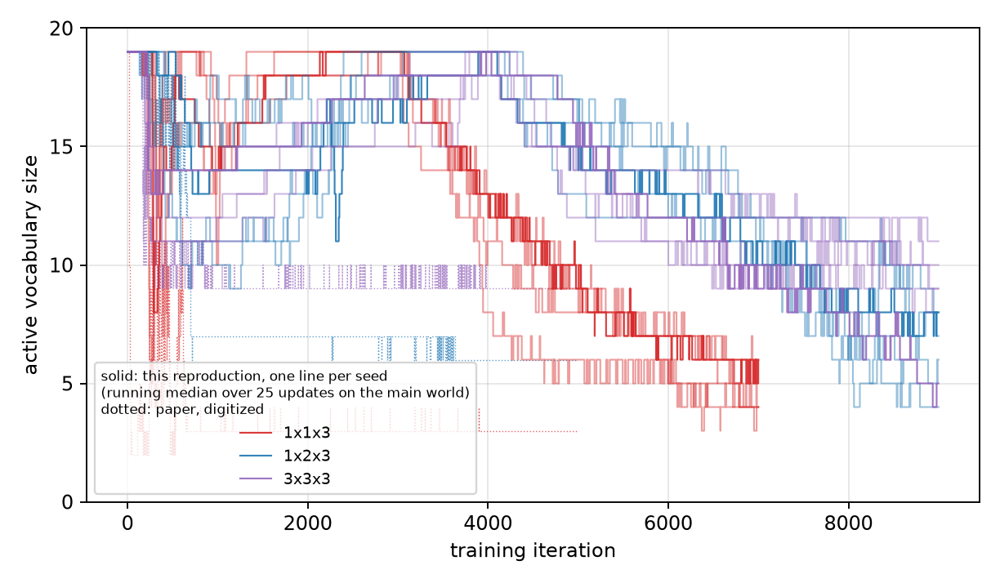
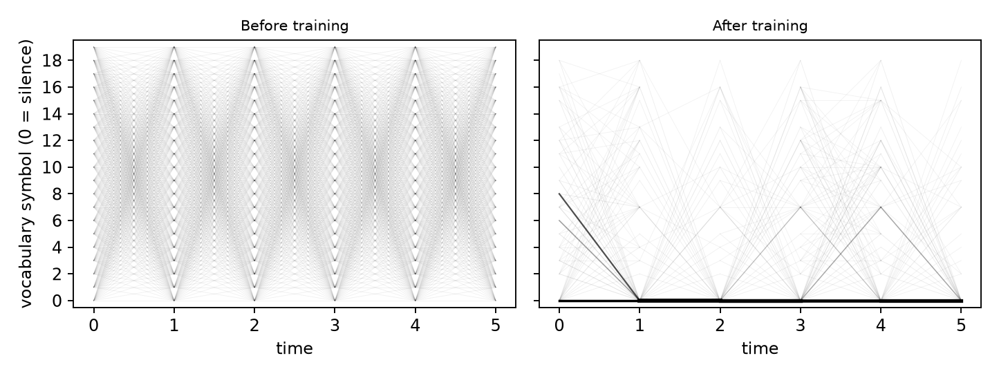
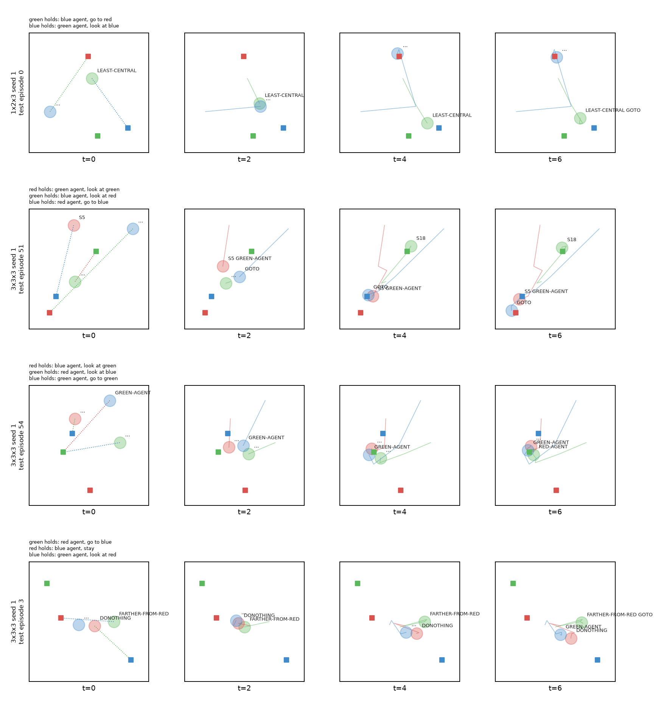
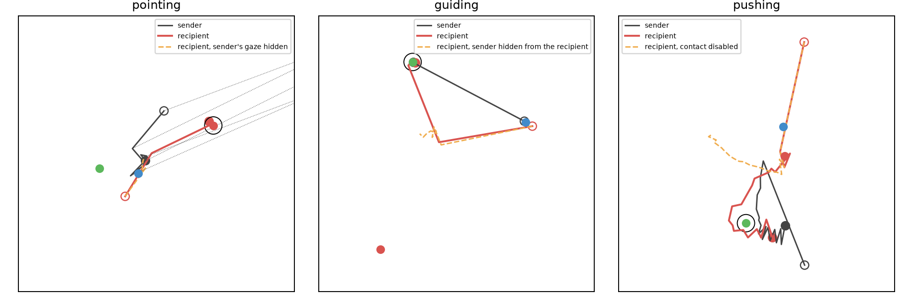

# Measured results

Generated by `python -m emlang.report`. Rewards are negative squared goal error averaged over goals and time steps unless a column says otherwise. Test numbers use 10,000 held-out worlds (4,000 for the probes of unseen configurations and of word omission) and exact categorical utterances. Brackets are 95% intervals over test episodes for one frozen checkpoint; "mean ± sd" is over training seeds.

## Table 1 · physical reward with and without communication

| World | Seed | No comm. train | Comm. train | No comm. test | Comm. test | Test gain (paired) | Comm. test / no comm. test |
|---|---:|---:|---:|---:|---:|---:|---:|
| Paper (world unspecified) | — | -0.919 | -0.332 | -0.920 | -0.392 | +0.528 | 0.43 |
| 1x1x3 | 1 | -0.595 | -0.309 | -0.596 | -0.389 | +0.207 [+0.202, +0.212] | 0.65 |
| 1x1x3 | 2 | -0.595 | -0.307 | -0.598 | -0.312 | +0.286 [+0.282, +0.290] | 0.52 |
| 1x1x3 | 3 | -0.595 | -0.310 | -0.597 | -0.393 | +0.203 [+0.199, +0.208] | 0.66 |
| 1x1x3 | 4 | -0.595 | -0.307 | -0.596 | -0.345 | +0.252 [+0.247, +0.256] | 0.58 |
| 1x1x3 | 5 | -0.595 | -0.308 | -0.598 | -0.360 | +0.239 [+0.234, +0.243] | 0.60 |
| 1x1x3 | mean ± sd, 5 comm. seeds against 3 baselines | | | | | +0.237 ± 0.034 | 0.60 ± 0.06 |
| 1x2x3 | 1 | -0.532 | -0.232 | -0.535 | -0.266 | +0.269 [+0.264, +0.274] | 0.50 |
| 1x2x3 | 2 | -0.532 | -0.217 | -0.534 | -0.330 | +0.203 [+0.198, +0.209] | 0.62 |
| 1x2x3 | 3 | -0.531 | -0.216 | -0.534 | -0.284 | +0.249 [+0.244, +0.254] | 0.53 |
| 1x2x3 | 4 | -0.532 | -0.215 | -0.535 | -0.309 | +0.226 [+0.221, +0.231] | 0.58 |
| 1x2x3 | 5 | -0.532 | -0.214 | -0.534 | -0.293 | +0.241 [+0.236, +0.246] | 0.55 |
| 1x2x3 | mean ± sd, 5 comm. seeds against 3 baselines | | | | | +0.238 ± 0.025 | 0.56 ± 0.05 |
| 3x3x3 | 1 | -0.363 | -0.167 | -0.361 | -0.233 | +0.128 [+0.125, +0.132] | 0.64 |
| 3x3x3 | 2 | -0.363 | -0.195 | -0.363 | -0.190 | +0.173 [+0.170, +0.177] | 0.52 |
| 3x3x3 | 3 | -0.362 | -0.214 | -0.363 | -0.203 | +0.160 [+0.157, +0.163] | 0.56 |
| 3x3x3 | 4 | -0.363 | -0.172 | -0.361 | -0.185 | +0.177 [+0.173, +0.180] | 0.51 |
| 3x3x3 | 5 | -0.363 | -0.196 | -0.363 | -0.202 | +0.161 [+0.158, +0.165] | 0.56 |
| 3x3x3 | mean ± sd, 5 comm. seeds against 3 baselines | | | | | +0.160 ± 0.019 | 0.56 ± 0.05 |

### Outcome at the end of the episode

| World | Seed | Terminal reward: no comm. | comm. (exact symbols) | comm. (relaxed symbols, as in training) | messages silenced | Addressee ends nearest the target landmark: no comm. | comm. | silenced |
|---|---:|---:|---:|---:|---:|---:|---:|---:|
| 1x1x3 | 1 | -0.447 | -0.109 | -0.004 | -0.589 | 0.333 | 0.750 | 0.336 |
| 1x1x3 | 2 | -0.449 | -0.015 | -0.007 | -0.784 | 0.333 | 0.923 | 0.337 |
| 1x1x3 | 3 | -0.448 | -0.111 | -0.007 | -0.592 | 0.333 | 0.758 | 0.333 |
| 1x1x3 | 4 | -0.447 | -0.059 | -0.006 | -0.610 | 0.333 | 0.833 | 0.336 |
| 1x1x3 | 5 | -0.449 | -0.073 | -0.004 | -0.607 | 0.333 | 0.823 | 0.332 |
| 1x1x3 | mean ± sd (5 comm. seeds, 3 baselines) | -0.448 ± 0.001 | -0.073 ± 0.040 | -0.005 ± 0.002 | -0.636 ± 0.083 | 0.333 ± 0.000 | 0.817 ± 0.070 | 0.335 ± 0.002 |
| 1x2x3 | 1 | -0.460 | -0.087 | -0.038 | -0.579 | 0.334 | 0.760 | 0.333 |
| 1x2x3 | 2 | -0.459 | -0.149 | -0.025 | -0.592 | 0.333 | 0.697 | 0.329 |
| 1x2x3 | 3 | -0.458 | -0.090 | -0.023 | -0.563 | 0.332 | 0.785 | 0.331 |
| 1x2x3 | 4 | -0.460 | -0.123 | -0.020 | -0.582 | 0.334 | 0.741 | 0.332 |
| 1x2x3 | 5 | -0.459 | -0.119 | -0.020 | -0.586 | 0.333 | 0.741 | 0.331 |
| 1x2x3 | mean ± sd (5 comm. seeds, 3 baselines) | -0.459 ± 0.001 | -0.114 ± 0.026 | -0.025 ± 0.007 | -0.580 ± 0.011 | 0.333 ± 0.001 | 0.745 ± 0.032 | 0.331 ± 0.002 |
| 3x3x3 | 1 | -0.327 | -0.121 | -0.026 | -0.495 | 0.340 | 0.616 | 0.341 |
| 3x3x3 | 2 | -0.329 | -0.077 | -0.072 | -0.591 | 0.341 | 0.602 | 0.342 |
| 3x3x3 | 3 | -0.330 | -0.094 | -0.087 | -0.434 | 0.340 | 0.601 | 0.332 |
| 3x3x3 | 4 | -0.327 | -0.062 | -0.030 | -0.506 | 0.340 | 0.821 | 0.322 |
| 3x3x3 | 5 | -0.329 | -0.090 | -0.086 | -0.470 | 0.341 | 0.595 | 0.338 |
| 3x3x3 | mean ± sd (5 comm. seeds, 3 baselines) | -0.328 ± 0.002 | -0.089 ± 0.022 | -0.060 ± 0.030 | -0.499 ± 0.058 | 0.340 ± 0.001 | 0.647 ± 0.098 | 0.335 ± 0.008 |

### The same test episodes under other reward reductions

| World | Seed | Condition | Step mean | Terminal | Step mean, summed over goals | Terminal, summed over goals |
|---|---:|---|---:|---:|---:|---:|
| 1x1x3 | 1 | no communication | -0.596 | -0.447 | -1.193 | -0.894 |
| 1x1x3 | 1 | communication | -0.389 | -0.109 | -0.779 | -0.217 |
| 1x1x3 | 1 | communication relaxed symbols | -0.305 | -0.004 | -0.609 | -0.007 |
| 1x1x3 | 1 | messages silenced | -0.672 | -0.589 | -1.343 | -1.178 |
| 1x1x3 | 2 | no communication | -0.598 | -0.449 | -1.197 | -0.898 |
| 1x1x3 | 2 | communication | -0.312 | -0.015 | -0.624 | -0.030 |
| 1x1x3 | 2 | communication relaxed symbols | -0.306 | -0.007 | -0.613 | -0.014 |
| 1x1x3 | 2 | messages silenced | -0.792 | -0.784 | -1.584 | -1.569 |
| 1x1x3 | 3 | no communication | -0.597 | -0.448 | -1.193 | -0.896 |
| 1x1x3 | 3 | communication | -0.393 | -0.111 | -0.786 | -0.222 |
| 1x1x3 | 3 | communication relaxed symbols | -0.307 | -0.007 | -0.614 | -0.014 |
| 1x1x3 | 3 | messages silenced | -0.677 | -0.592 | -1.354 | -1.184 |
| 1x1x3 | 4 | no communication | -0.596 | -0.447 | -1.193 | -0.894 |
| 1x1x3 | 4 | communication | -0.345 | -0.059 | -0.690 | -0.118 |
| 1x1x3 | 4 | communication relaxed symbols | -0.306 | -0.006 | -0.611 | -0.012 |
| 1x1x3 | 4 | messages silenced | -0.687 | -0.610 | -1.374 | -1.219 |
| 1x1x3 | 5 | no communication | -0.598 | -0.449 | -1.197 | -0.898 |
| 1x1x3 | 5 | communication | -0.360 | -0.073 | -0.720 | -0.145 |
| 1x1x3 | 5 | communication relaxed symbols | -0.305 | -0.004 | -0.610 | -0.007 |
| 1x1x3 | 5 | messages silenced | -0.687 | -0.607 | -1.373 | -1.213 |
| 1x2x3 | 1 | no communication | -0.535 | -0.460 | -1.070 | -0.919 |
| 1x2x3 | 1 | communication | -0.266 | -0.087 | -0.533 | -0.174 |
| 1x2x3 | 1 | communication relaxed symbols | -0.228 | -0.038 | -0.456 | -0.075 |
| 1x2x3 | 1 | messages silenced | -0.620 | -0.579 | -1.240 | -1.159 |
| 1x2x3 | 2 | no communication | -0.534 | -0.459 | -1.067 | -0.917 |
| 1x2x3 | 2 | communication | -0.330 | -0.149 | -0.661 | -0.298 |
| 1x2x3 | 2 | communication relaxed symbols | -0.215 | -0.025 | -0.430 | -0.050 |
| 1x2x3 | 2 | messages silenced | -0.614 | -0.592 | -1.228 | -1.184 |
| 1x2x3 | 3 | no communication | -0.534 | -0.458 | -1.067 | -0.916 |
| 1x2x3 | 3 | communication | -0.284 | -0.090 | -0.569 | -0.181 |
| 1x2x3 | 3 | communication relaxed symbols | -0.212 | -0.023 | -0.424 | -0.046 |
| 1x2x3 | 3 | messages silenced | -0.605 | -0.563 | -1.209 | -1.126 |
| 1x2x3 | 4 | no communication | -0.535 | -0.460 | -1.070 | -0.919 |
| 1x2x3 | 4 | communication | -0.309 | -0.123 | -0.619 | -0.246 |
| 1x2x3 | 4 | communication relaxed symbols | -0.211 | -0.020 | -0.421 | -0.041 |
| 1x2x3 | 4 | messages silenced | -0.607 | -0.582 | -1.214 | -1.164 |
| 1x2x3 | 5 | no communication | -0.534 | -0.459 | -1.067 | -0.917 |
| 1x2x3 | 5 | communication | -0.293 | -0.119 | -0.586 | -0.237 |
| 1x2x3 | 5 | communication relaxed symbols | -0.209 | -0.020 | -0.418 | -0.040 |
| 1x2x3 | 5 | messages silenced | -0.610 | -0.586 | -1.220 | -1.171 |
| 3x3x3 | 1 | no communication | -0.361 | -0.327 | -1.084 | -0.980 |
| 3x3x3 | 1 | communication | -0.233 | -0.121 | -0.699 | -0.362 |
| 3x3x3 | 1 | communication relaxed symbols | -0.153 | -0.026 | -0.459 | -0.077 |
| 3x3x3 | 1 | messages silenced | -0.470 | -0.495 | -1.409 | -1.484 |
| 3x3x3 | 2 | no communication | -0.363 | -0.329 | -1.090 | -0.986 |
| 3x3x3 | 2 | communication | -0.190 | -0.077 | -0.570 | -0.232 |
| 3x3x3 | 2 | communication relaxed symbols | -0.186 | -0.072 | -0.558 | -0.217 |
| 3x3x3 | 2 | messages silenced | -0.522 | -0.591 | -1.565 | -1.773 |
| 3x3x3 | 3 | no communication | -0.363 | -0.330 | -1.090 | -0.989 |
| 3x3x3 | 3 | communication | -0.203 | -0.094 | -0.610 | -0.281 |
| 3x3x3 | 3 | communication relaxed symbols | -0.199 | -0.087 | -0.597 | -0.262 |
| 3x3x3 | 3 | messages silenced | -0.428 | -0.434 | -1.285 | -1.301 |
| 3x3x3 | 4 | no communication | -0.361 | -0.327 | -1.084 | -0.980 |
| 3x3x3 | 4 | communication | -0.185 | -0.062 | -0.554 | -0.186 |
| 3x3x3 | 4 | communication relaxed symbols | -0.158 | -0.030 | -0.474 | -0.089 |
| 3x3x3 | 4 | messages silenced | -0.463 | -0.506 | -1.388 | -1.518 |
| 3x3x3 | 5 | no communication | -0.363 | -0.329 | -1.090 | -0.986 |
| 3x3x3 | 5 | communication | -0.202 | -0.090 | -0.606 | -0.271 |
| 3x3x3 | 5 | communication relaxed symbols | -0.198 | -0.086 | -0.593 | -0.257 |
| 3x3x3 | 5 | messages silenced | -0.459 | -0.470 | -1.378 | -1.409 |

## Figure 6 · active vocabulary size

| World | Paper | Seed | Final active words in training (median over the last 200 updates on the main world) | Active words on test | Words above 1% of utterance slots on test | Words with a clear meaning (precision ≥ 0.8, at least 0.2 above the base rate) |
|---|---:|---:|---:|---:|---:|---|
| 1x1x3 | 3 | 1 | 6 | 7 | 3 | FARTHER-FROM-GREEN, FARTHER-FROM-GREEN, GREEN, GREEN, GREEN |
| 1x1x3 | 3 | 2 | 4 | 4 | 3 | BLUE |
| 1x1x3 | 3 | 3 | 6 | 8 | 5 | FARTHER-FROM-GREEN, FARTHER-FROM-GREEN, FARTHER-FROM-GREEN, GREEN, GREEN, GREEN |
| 1x1x3 | 3 | 4 | 4 | 5 | 3 | FARTHER-FROM-GREEN, FARTHER-FROM-GREEN, FARTHER-FROM-GREEN, GREEN |
| 1x1x3 | 3 | 5 | 4 | 6 | 2 | FARTHER-FROM-RED, FARTHER-FROM-RED, FARTHER-FROM-RED, RED |
| 1x1x3 | 3 | mean ± sd over 5 seeds | 4.8 ± 1.1 | 6.0 ± 1.6 | 3.2 ± 1.1 | |
| 1x2x3 | 6 | 1 | 8 | 12 | 4 | GOTO, LEAST-CENTRAL, LEAST-CENTRAL, LEAST-CENTRAL, LEAST-CENTRAL |
| 1x2x3 | 6 | 2 | 6 | 13 | 5 | FARTHER-FROM-RED, FARTHER-FROM-RED, FARTHER-FROM-RED, FARTHER-FROM-RED, FARTHER-FROM-RED, GOTO, RED, RED, RED, RED |
| 1x2x3 | 6 | 3 | 9 | 12 | 8 | BLUE, BLUE, BLUE, BLUE, FARTHER-FROM-BLUE, FARTHER-FROM-BLUE, LOOKAT |
| 1x2x3 | 6 | 4 | 4 | 13 | 5 | BLUE, BLUE, BLUE, BLUE, FARTHER-FROM-BLUE, FARTHER-FROM-BLUE, FARTHER-FROM-BLUE, GOTO |
| 1x2x3 | 6 | 5 | 8 | 12 | 6 | FARTHER-FROM-BLUE, FARTHER-FROM-BLUE, GOTO, GOTO |
| 1x2x3 | 6 | mean ± sd over 5 seeds | 7.0 ± 2.0 | 12.4 ± 0.5 | 5.6 ± 1.5 | |
| 3x3x3 | 9 | 1 | 5 | 12 | 6 | DONOTHING, FARTHER-FROM-RED, FARTHER-FROM-RED, GOTO, GOTO, GREEN-AGENT, RED, RED, RED-AGENT, RED-AGENT |
| 3x3x3 | 9 | 2 | 9 | 11 | 5 | BLUE-AGENT, DONOTHING, GREEN-AGENT, LEAST-CENTRAL, LEAST-CENTRAL, LEAST-CENTRAL, LEAST-CENTRAL, LOOKAT, OWN-GOAL, RED-AGENT |
| 3x3x3 | 9 | 3 | 12 | 12 | 7 | BLUE-AGENT, DONOTHING, DONOTHING, GOTO, GOTO, LEAST-CENTRAL, LEAST-CENTRAL, LEAST-CENTRAL, LEAST-CENTRAL, LOOKAT, RED-AGENT, RED-AGENT |
| 3x3x3 | 9 | 4 | 10 | 12 | 5 | DONOTHING, GOTO, GREEN, GREEN-AGENT, GREEN-AGENT, NEARER-TO-GREEN, OWN-GOAL, RED-AGENT, RED-AGENT |
| 3x3x3 | 9 | 5 | 10 | 14 | 4 | BLUE-AGENT, BLUE-AGENT, DONOTHING, GOTO, GOTO, LEAST-CENTRAL, RED-AGENT, RED-AGENT, RED-AGENT |
| 3x3x3 | 9 | mean ± sd over 5 seeds | 9.2 ± 2.6 | 12.2 ± 1.1 | 5.4 ± 1.1 | |

## Figure 5 · symbol streams before and after training

## Figure 4 · example test episodes

## Word meanings, order and omission

### 1x1x3 · seed 1

| Symbol | Meaning | Precision | Recall (directed goals) | Share of utterance slots | Mean first step |
|---:|---|---:|---:|---:|---:|
| 4 | GREEN (GREEN) | 0.953 | 0.220 | 0.013 | 0.80 |
| 8 | GREEN (GREEN) | 0.924 | 0.275 | 0.017 | 0.86 |
| 12 | GREEN (GREEN) | 0.905 | 0.144 | 0.009 | 1.21 |
| 2 | FARTHER-FROM-GREEN (FARTHER-FROM-GREEN) | 0.954 | 0.156 | 0.009 | 0.44 |
| 7 | S7 (FARTHER-FROM-GREEN) | 0.609 | 0.098 | 0.009 | 0.47 |
| 13 | FARTHER-FROM-GREEN (FARTHER-FROM-GREEN) | 0.856 | 0.143 | 0.010 | 0.97 |
| 14 | S14 (FARTHER-FROM-GREEN) | 0.656 | 0.160 | 0.014 | 0.33 |

| Goal factor decoded from the set of words in a stream (held-out) | Accuracy | Majority guess | Reference |
|---|---:|---:|---|
| action | 1.000 | 1.000 |  |
| landmark | 0.543 | 0.336 | 0.778 when the decoder also sees the landmark layout (layout alone: 0.337) |
| centroid rank | 0.521 | 0.332 | a pure colour vocabulary would score 0.334 |
| relative to RED | 0.485 | 0.336 | a pure colour vocabulary would score 0.664 |
| relative to GREEN | 0.718 | 0.338 | a pure colour vocabulary would score 0.666 |
| relative to BLUE | 0.481 | 0.332 | a pure colour vocabulary would score 0.673 |

- Word sets too rare to decode as a whole (decoded word by word instead): 0.010 of the landmark streams (0.057 when decoding within a layout class).
- Utterances per stream: 0.63 [0.62, 0.64] for goals addressed to another agent.
- Share of non-silent utterances by step: t=0: 0.31, t=1: 0.18, t=2: 0.05, t=3: 0.03, t=4: 0.05, t=5: 0.01.

| Test world | Streams using an action word | a landmark colour word | a landmark position word | an addressee word | Utterances per stream |
|---|---:|---:|---:|---:|---:|
| full | — | 0.221 | 0.112 | — | 0.64 |
| two landmarks | — | 0.266 | 0.067 | — | 0.60 |
| one landmark | — | 0.239 | 0.037 | — | 0.49 |

### 1x1x3 · seed 2

| Symbol | Meaning | Precision | Recall (directed goals) | Share of utterance slots | Mean first step |
|---:|---|---:|---:|---:|---:|
| 7 | BLUE (BLUE) | 0.907 | 0.999 | 0.062 | 0.00 |
| 11 | S11 (FARTHER-FROM-BLUE) | 0.712 | 0.105 | 0.009 | 1.46 |
| 5 | S5 (NEARER-TO-BLUE) | 0.576 | 0.220 | 0.021 | 0.01 |
| 16 | S16 (NEARER-TO-BLUE) | 0.554 | 0.187 | 0.019 | 0.02 |

| Goal factor decoded from the set of words in a stream (held-out) | Accuracy | Majority guess | Reference |
|---|---:|---:|---|
| action | 1.000 | 1.000 |  |
| landmark | 0.655 | 0.336 | 0.930 when the decoder also sees the landmark layout (layout alone: 0.337) |
| centroid rank | 0.400 | 0.332 | a pure colour vocabulary would score 0.334 |
| relative to RED | 0.497 | 0.336 | a pure colour vocabulary would score 0.664 |
| relative to GREEN | 0.490 | 0.338 | a pure colour vocabulary would score 0.666 |
| relative to BLUE | 0.706 | 0.332 | a pure colour vocabulary would score 0.673 |

- Word sets too rare to decode as a whole (decoded word by word instead): 0.004 of the landmark streams (0.068 when decoding within a layout class).
- Utterances per stream: 0.77 [0.76, 0.77] for goals addressed to another agent.
- Share of non-silent utterances by step: t=0: 0.67, t=1: 0.02, t=2: 0.01, t=3: 0.02, t=4: 0.04, t=5: 0.00.

| Test world | Streams using an action word | a landmark colour word | a landmark position word | an addressee word | Utterances per stream |
|---|---:|---:|---:|---:|---:|
| full | — | 0.361 | — | — | 0.77 |
| two landmarks | — | 0.378 | — | — | 0.71 |
| one landmark | — | 0.599 | — | — | 0.78 |

### 1x1x3 · seed 3

| Symbol | Meaning | Precision | Recall (directed goals) | Share of utterance slots | Mean first step |
|---:|---|---:|---:|---:|---:|
| 4 | GREEN (GREEN) | 0.862 | 0.280 | 0.019 | 1.18 |
| 5 | GREEN (GREEN) | 0.962 | 0.239 | 0.015 | 0.84 |
| 16 | GREEN (GREEN) | 0.900 | 0.205 | 0.013 | 1.14 |
| 2 | FARTHER-FROM-GREEN (FARTHER-FROM-GREEN) | 0.819 | 0.152 | 0.011 | 1.17 |
| 6 | FARTHER-FROM-GREEN (FARTHER-FROM-GREEN) | 0.949 | 0.100 | 0.006 | 0.83 |
| 7 | S7 (FARTHER-FROM-GREEN) | 0.782 | 0.092 | 0.007 | 1.53 |
| 10 | FARTHER-FROM-GREEN (FARTHER-FROM-GREEN) | 0.986 | 0.158 | 0.009 | 0.28 |
| 18 | S18 (FARTHER-FROM-GREEN) | 0.569 | 0.107 | 0.011 | 1.08 |

| Goal factor decoded from the set of words in a stream (held-out) | Accuracy | Majority guess | Reference |
|---|---:|---:|---|
| action | 1.000 | 1.000 |  |
| landmark | 0.566 | 0.336 | 0.801 when the decoder also sees the landmark layout (layout alone: 0.337) |
| centroid rank | 0.516 | 0.332 | a pure colour vocabulary would score 0.334 |
| relative to RED | 0.471 | 0.336 | a pure colour vocabulary would score 0.664 |
| relative to GREEN | 0.745 | 0.338 | a pure colour vocabulary would score 0.666 |
| relative to BLUE | 0.489 | 0.332 | a pure colour vocabulary would score 0.673 |

- Word sets too rare to decode as a whole (decoded word by word instead): 0.014 of the landmark streams (0.072 when decoding within a layout class).
- Utterances per stream: 0.69 [0.69, 0.70] for goals addressed to another agent.
- Share of non-silent utterances by step: t=0: 0.32, t=1: 0.18, t=2: 0.07, t=3: 0.04, t=4: 0.06, t=5: 0.02.

| Test world | Streams using an action word | a landmark colour word | a landmark position word | an addressee word | Utterances per stream |
|---|---:|---:|---:|---:|---:|
| full | — | 0.254 | 0.150 | — | 0.70 |
| two landmarks | — | 0.295 | 0.095 | — | 0.64 |
| one landmark | — | 0.201 | 0.051 | — | 0.35 |

### 1x1x3 · seed 4

| Symbol | Meaning | Precision | Recall (directed goals) | Share of utterance slots | Mean first step |
|---:|---|---:|---:|---:|---:|
| 2 | GREEN (GREEN) | 0.982 | 0.831 | 0.047 | 0.12 |
| 4 | FARTHER-FROM-GREEN (FARTHER-FROM-GREEN) | 0.852 | 0.115 | 0.008 | 0.76 |
| 6 | FARTHER-FROM-GREEN (FARTHER-FROM-GREEN) | 0.939 | 0.176 | 0.011 | 0.35 |
| 11 | FARTHER-FROM-GREEN (FARTHER-FROM-GREEN) | 0.829 | 0.300 | 0.022 | 0.73 |
| 5 | S5 (NEARER-TO-GREEN) | 0.550 | 0.079 | 0.008 | 1.25 |

| Goal factor decoded from the set of words in a stream (held-out) | Accuracy | Majority guess | Reference |
|---|---:|---:|---|
| action | 1.000 | 1.000 |  |
| landmark | 0.610 | 0.336 | 0.847 when the decoder also sees the landmark layout (layout alone: 0.337) |
| centroid rank | 0.533 | 0.332 | a pure colour vocabulary would score 0.334 |
| relative to RED | 0.487 | 0.336 | a pure colour vocabulary would score 0.664 |
| relative to GREEN | 0.821 | 0.338 | a pure colour vocabulary would score 0.666 |
| relative to BLUE | 0.490 | 0.332 | a pure colour vocabulary would score 0.673 |

- Word sets too rare to decode as a whole (decoded word by word instead): 0.009 of the landmark streams (0.063 when decoding within a layout class).
- Utterances per stream: 0.72 [0.71, 0.73] for goals addressed to another agent.
- Share of non-silent utterances by step: t=0: 0.50, t=1: 0.10, t=2: 0.02, t=3: 0.04, t=4: 0.06, t=5: 0.01.

| Test world | Streams using an action word | a landmark colour word | a landmark position word | an addressee word | Utterances per stream |
|---|---:|---:|---:|---:|---:|
| full | — | 0.276 | 0.229 | — | 0.72 |
| two landmarks | — | 0.296 | 0.155 | — | 0.62 |
| one landmark | — | 0.338 | 0.153 | — | 0.86 |

### 1x1x3 · seed 5

| Symbol | Meaning | Precision | Recall (directed goals) | Share of utterance slots | Mean first step |
|---:|---|---:|---:|---:|---:|
| 9 | RED (RED) | 0.945 | 0.876 | 0.056 | 0.37 |
| 5 | FARTHER-FROM-RED (FARTHER-FROM-RED) | 0.802 | 0.107 | 0.008 | 1.16 |
| 6 | S6 (FARTHER-FROM-RED) | 0.604 | 0.061 | 0.006 | 0.88 |
| 8 | FARTHER-FROM-RED (FARTHER-FROM-RED) | 0.865 | 0.203 | 0.014 | 0.76 |
| 16 | FARTHER-FROM-RED (FARTHER-FROM-RED) | 0.894 | 0.151 | 0.010 | 0.66 |
| 18 | S18 (FARTHER-FROM-RED) | 0.663 | 0.059 | 0.005 | 1.40 |

| Goal factor decoded from the set of words in a stream (held-out) | Accuracy | Majority guess | Reference |
|---|---:|---:|---|
| action | 1.000 | 1.000 |  |
| landmark | 0.614 | 0.336 | 0.849 when the decoder also sees the landmark layout (layout alone: 0.337) |
| centroid rank | 0.500 | 0.332 | a pure colour vocabulary would score 0.334 |
| relative to RED | 0.810 | 0.336 | a pure colour vocabulary would score 0.664 |
| relative to GREEN | 0.481 | 0.338 | a pure colour vocabulary would score 0.666 |
| relative to BLUE | 0.481 | 0.332 | a pure colour vocabulary would score 0.673 |

- Word sets too rare to decode as a whole (decoded word by word instead): 0.010 of the landmark streams (0.072 when decoding within a layout class).
- Utterances per stream: 0.74 [0.73, 0.75] for goals addressed to another agent.
- Share of non-silent utterances by step: t=0: 0.43, t=1: 0.15, t=2: 0.04, t=3: 0.04, t=4: 0.06, t=5: 0.01.

| Test world | Streams using an action word | a landmark colour word | a landmark position word | an addressee word | Utterances per stream |
|---|---:|---:|---:|---:|---:|
| full | — | 0.315 | 0.177 | — | 0.74 |
| two landmarks | — | 0.320 | 0.094 | — | 0.64 |
| one landmark | — | 0.390 | 0.005 | — | 0.47 |

### 1x2x3 · seed 1

| Symbol | Meaning | Precision | Recall (directed goals) | Share of utterance slots | Mean first step |
|---:|---|---:|---:|---:|---:|
| 13 | GOTO (GOTO) | 1.000 | 0.959 | 0.081 | 4.00 |
| 1 | LEAST-CENTRAL (LEAST-CENTRAL) | 0.973 | 0.103 | 0.006 | 0.42 |
| 2 | LEAST-CENTRAL (LEAST-CENTRAL) | 0.974 | 0.297 | 0.017 | 0.16 |
| 7 | LEAST-CENTRAL (LEAST-CENTRAL) | 0.891 | 0.241 | 0.015 | 0.96 |
| 8 | LEAST-CENTRAL (LEAST-CENTRAL) | 0.951 | 0.286 | 0.017 | 0.24 |
| 4 | S4 (MID-CENTRAL) | 0.573 | 0.088 | 0.009 | 1.53 |
| 5 | S5 (MID-CENTRAL) | 0.745 | 0.077 | 0.006 | 0.73 |
| 6 | S6 (MID-CENTRAL) | 0.665 | 0.065 | 0.006 | 1.19 |
| 11 | S11 (MID-CENTRAL) | 0.689 | 0.087 | 0.007 | 1.15 |
| 12 | S12 (MID-CENTRAL) | 0.708 | 0.096 | 0.008 | 0.73 |
| 14 | S14 (MID-CENTRAL) | 0.720 | 0.064 | 0.005 | 0.66 |
| 15 | S15 (MID-CENTRAL) | 0.632 | 0.058 | 0.005 | 1.05 |

| Goal factor decoded from the set of words in a stream (held-out) | Accuracy | Majority guess | Reference |
|---|---:|---:|---|
| action | 0.991 | 0.501 |  |
| landmark | 0.342 | 0.336 | 0.790 when the decoder also sees the landmark layout (layout alone: 0.337) |
| centroid rank | 0.761 | 0.332 | a pure colour vocabulary would score 0.334 |
| relative to RED | 0.523 | 0.336 | a pure colour vocabulary would score 0.664 |
| relative to GREEN | 0.531 | 0.338 | a pure colour vocabulary would score 0.666 |
| relative to BLUE | 0.514 | 0.332 | a pure colour vocabulary would score 0.673 |

- Word sets too rare to decode as a whole (decoded word by word instead): 0.021 of the landmark streams (0.108 when decoding within a layout class).
- Utterances per stream: 1.16 [1.15, 1.17] for goals addressed to another agent.
- Share of non-silent utterances by step: t=0: 0.41, t=1: 0.08, t=2: 0.08, t=3: 0.05, t=4: 0.53, t=5: 0.01.

| Test world | Streams using an action word | a landmark colour word | a landmark position word | an addressee word | Utterances per stream |
|---|---:|---:|---:|---:|---:|
| full | 0.495 | — | 0.304 | — | 1.16 |
| two landmarks | 0.486 | — | 0.228 | — | 1.02 |
| one landmark | 0.499 | — | 0.000 | — | 0.50 |
| goto only | 0.960 | — | 0.295 | — | 1.61 |

### 1x2x3 · seed 2

| Symbol | Meaning | Precision | Recall (directed goals) | Share of utterance slots | Mean first step |
|---:|---|---:|---:|---:|---:|
| 6 | GOTO (GOTO) | 1.000 | 0.996 | 0.084 | 4.01 |
| 2 | RED (RED) | 0.954 | 0.171 | 0.010 | 1.16 |
| 15 | RED (RED) | 0.928 | 0.253 | 0.016 | 1.04 |
| 16 | RED (RED) | 0.924 | 0.125 | 0.008 | 1.36 |
| 18 | RED (RED) | 0.895 | 0.107 | 0.007 | 1.62 |
| 1 | FARTHER-FROM-RED (FARTHER-FROM-RED) | 0.875 | 0.091 | 0.006 | 1.32 |
| 4 | FARTHER-FROM-RED (FARTHER-FROM-RED) | 0.876 | 0.120 | 0.008 | 1.01 |
| 7 | FARTHER-FROM-RED (FARTHER-FROM-RED) | 0.903 | 0.087 | 0.006 | 1.19 |
| 9 | FARTHER-FROM-RED (FARTHER-FROM-RED) | 0.925 | 0.137 | 0.009 | 0.56 |
| 10 | S10 (FARTHER-FROM-RED) | 0.574 | 0.051 | 0.005 | 0.47 |
| 11 | FARTHER-FROM-RED (FARTHER-FROM-RED) | 0.886 | 0.130 | 0.009 | 1.08 |
| 13 | S13 (FARTHER-FROM-RED) | 0.676 | 0.117 | 0.010 | 0.42 |
| 19 | S19 (FARTHER-FROM-RED) | 0.666 | 0.110 | 0.010 | 0.37 |

| Goal factor decoded from the set of words in a stream (held-out) | Accuracy | Majority guess | Reference |
|---|---:|---:|---|
| action | 0.998 | 0.501 |  |
| landmark | 0.550 | 0.336 | 0.782 when the decoder also sees the landmark layout (layout alone: 0.337) |
| centroid rank | 0.500 | 0.332 | a pure colour vocabulary would score 0.334 |
| relative to RED | 0.720 | 0.336 | a pure colour vocabulary would score 0.664 |
| relative to GREEN | 0.476 | 0.338 | a pure colour vocabulary would score 0.666 |
| relative to BLUE | 0.477 | 0.332 | a pure colour vocabulary would score 0.673 |

- `action_before_landmark`: 0.005 of 2,164 streams containing both.
- GOTO word before the landmark word: 0.005 of 2,164 streams.
- Word sets too rare to decode as a whole (decoded word by word instead): 0.012 of the landmark streams (0.083 when decoding within a layout class).
- Utterances per stream: 1.19 [1.18, 1.21] for goals addressed to another agent.
- Share of non-silent utterances by step: t=0: 0.31, t=1: 0.17, t=2: 0.11, t=3: 0.09, t=4: 0.50, t=5: 0.02.

| Test world | Streams using an action word | a landmark colour word | a landmark position word | an addressee word | Utterances per stream |
|---|---:|---:|---:|---:|---:|
| full | 0.512 | 0.226 | 0.189 | — | 1.19 |
| two landmarks | 0.497 | 0.213 | 0.092 | — | 0.88 |
| one landmark | 0.499 | 0.000 | 0.000 | — | 0.50 |
| goto only | 0.994 | 0.219 | 0.186 | — | 1.65 |

### 1x2x3 · seed 3

| Symbol | Meaning | Precision | Recall (directed goals) | Share of utterance slots | Mean first step |
|---:|---|---:|---:|---:|---:|
| 3 | LOOKAT (LOOKAT) | 1.000 | 0.992 | 0.084 | 4.01 |
| 2 | BLUE (BLUE) | 0.856 | 0.140 | 0.009 | 1.45 |
| 9 | BLUE (BLUE) | 0.862 | 0.208 | 0.014 | 1.31 |
| 10 | BLUE (BLUE) | 0.872 | 0.170 | 0.011 | 1.36 |
| 14 | BLUE (BLUE) | 0.940 | 0.266 | 0.016 | 1.02 |
| 1 | S1 (FARTHER-FROM-BLUE) | 0.708 | 0.151 | 0.012 | 0.43 |
| 6 | FARTHER-FROM-BLUE (FARTHER-FROM-BLUE) | 0.918 | 0.184 | 0.011 | 0.51 |
| 7 | S7 (FARTHER-FROM-BLUE) | 0.749 | 0.112 | 0.009 | 1.48 |
| 11 | S11 (FARTHER-FROM-BLUE) | 0.632 | 0.118 | 0.011 | 0.50 |
| 15 | S15 (FARTHER-FROM-BLUE) | 0.729 | 0.149 | 0.012 | 0.56 |
| 16 | S16 (FARTHER-FROM-BLUE) | 0.746 | 0.111 | 0.009 | 1.59 |
| 17 | FARTHER-FROM-BLUE (FARTHER-FROM-BLUE) | 0.857 | 0.138 | 0.009 | 1.00 |

| Goal factor decoded from the set of words in a stream (held-out) | Accuracy | Majority guess | Reference |
|---|---:|---:|---|
| action | 0.998 | 0.501 |  |
| landmark | 0.571 | 0.336 | 0.815 when the decoder also sees the landmark layout (layout alone: 0.337) |
| centroid rank | 0.501 | 0.332 | a pure colour vocabulary would score 0.334 |
| relative to RED | 0.476 | 0.336 | a pure colour vocabulary would score 0.664 |
| relative to GREEN | 0.488 | 0.338 | a pure colour vocabulary would score 0.666 |
| relative to BLUE | 0.751 | 0.332 | a pure colour vocabulary would score 0.673 |

- `action_before_landmark`: 0.003 of 2,576 streams containing both.
- Word sets too rare to decode as a whole (decoded word by word instead): 0.020 of the landmark streams (0.088 when decoding within a layout class).
- Utterances per stream: 1.26 [1.25, 1.27] for goals addressed to another agent.
- Share of non-silent utterances by step: t=0: 0.34, t=1: 0.20, t=2: 0.10, t=3: 0.07, t=4: 0.53, t=5: 0.02.

| Test world | Streams using an action word | a landmark colour word | a landmark position word | an addressee word | Utterances per stream |
|---|---:|---:|---:|---:|---:|
| full | 0.481 | 0.268 | 0.126 | — | 1.24 |
| two landmarks | 0.496 | 0.241 | 0.064 | — | 0.95 |
| one landmark | 0.501 | 0.000 | 0.000 | — | 0.50 |
| goto only | 0.000 | 0.273 | 0.126 | — | 0.76 |

### 1x2x3 · seed 4

| Symbol | Meaning | Precision | Recall (directed goals) | Share of utterance slots | Mean first step |
|---:|---|---:|---:|---:|---:|
| 9 | GOTO (GOTO) | 1.000 | 0.956 | 0.081 | 4.02 |
| 2 | BLUE (BLUE) | 0.935 | 0.177 | 0.011 | 1.24 |
| 4 | BLUE (BLUE) | 0.948 | 0.159 | 0.010 | 1.25 |
| 17 | BLUE (BLUE) | 0.929 | 0.156 | 0.010 | 1.35 |
| 18 | BLUE (BLUE) | 0.919 | 0.230 | 0.015 | 1.03 |
| 15 | S15 (RED) | 0.506 | 0.052 | 0.006 | 0.68 |
| 6 | FARTHER-FROM-BLUE (FARTHER-FROM-BLUE) | 0.959 | 0.224 | 0.013 | 0.34 |
| 7 | S7 (FARTHER-FROM-BLUE) | 0.675 | 0.090 | 0.008 | 0.57 |
| 8 | S8 (FARTHER-FROM-BLUE) | 0.554 | 0.051 | 0.006 | 0.65 |
| 10 | S10 (FARTHER-FROM-BLUE) | 0.722 | 0.085 | 0.007 | 0.74 |
| 11 | S11 (FARTHER-FROM-BLUE) | 0.639 | 0.070 | 0.006 | 2.54 |
| 14 | FARTHER-FROM-BLUE (FARTHER-FROM-BLUE) | 0.818 | 0.103 | 0.007 | 1.42 |
| 19 | FARTHER-FROM-BLUE (FARTHER-FROM-BLUE) | 0.919 | 0.196 | 0.013 | 0.47 |

| Goal factor decoded from the set of words in a stream (held-out) | Accuracy | Majority guess | Reference |
|---|---:|---:|---|
| action | 0.988 | 0.501 |  |
| landmark | 0.553 | 0.336 | 0.800 when the decoder also sees the landmark layout (layout alone: 0.337) |
| centroid rank | 0.513 | 0.332 | a pure colour vocabulary would score 0.334 |
| relative to RED | 0.478 | 0.336 | a pure colour vocabulary would score 0.664 |
| relative to GREEN | 0.478 | 0.338 | a pure colour vocabulary would score 0.666 |
| relative to BLUE | 0.741 | 0.332 | a pure colour vocabulary would score 0.673 |

- `action_before_landmark`: 0.004 of 2,298 streams containing both.
- GOTO word before the landmark word: 0.004 of 2,298 streams.
- Word sets too rare to decode as a whole (decoded word by word instead): 0.024 of the landmark streams (0.099 when decoding within a layout class).
- Utterances per stream: 1.22 [1.21, 1.23] for goals addressed to another agent.
- Share of non-silent utterances by step: t=0: 0.34, t=1: 0.16, t=2: 0.10, t=3: 0.08, t=4: 0.52, t=5: 0.02.

| Test world | Streams using an action word | a landmark colour word | a landmark position word | an addressee word | Utterances per stream |
|---|---:|---:|---:|---:|---:|
| full | 0.492 | 0.238 | 0.186 | — | 1.23 |
| two landmarks | 0.480 | 0.236 | 0.104 | — | 0.94 |
| one landmark | 0.499 | 0.000 | 0.000 | — | 0.50 |
| goto only | 0.949 | 0.234 | 0.192 | — | 1.68 |

### 1x2x3 · seed 5

| Symbol | Meaning | Precision | Recall (directed goals) | Share of utterance slots | Mean first step |
|---:|---|---:|---:|---:|---:|
| 12 | GOTO (GOTO) | 0.835 | 0.070 | 0.007 | 2.28 |
| 17 | GOTO (GOTO) | 0.833 | 0.176 | 0.019 | 2.38 |
| 1 | S1 (BLUE) | 0.676 | 0.121 | 0.011 | 2.10 |
| 5 | S5 (BLUE) | 0.635 | 0.156 | 0.015 | 2.14 |
| 10 | S10 (BLUE) | 0.622 | 0.237 | 0.024 | 2.07 |
| 4 | S4 (FARTHER-FROM-BLUE) | 0.636 | 0.062 | 0.006 | 0.35 |
| 7 | S7 (FARTHER-FROM-BLUE) | 0.573 | 0.057 | 0.006 | 0.39 |
| 8 | FARTHER-FROM-BLUE (FARTHER-FROM-BLUE) | 0.879 | 0.188 | 0.012 | 0.54 |
| 9 | S9 (FARTHER-FROM-BLUE) | 0.789 | 0.110 | 0.008 | 1.06 |
| 14 | S14 (FARTHER-FROM-BLUE) | 0.595 | 0.054 | 0.005 | 0.40 |
| 16 | FARTHER-FROM-BLUE (FARTHER-FROM-BLUE) | 0.911 | 0.235 | 0.015 | 0.41 |
| 19 | S19 (FARTHER-FROM-BLUE) | 0.654 | 0.086 | 0.008 | 0.29 |

| Goal factor decoded from the set of words in a stream (held-out) | Accuracy | Majority guess | Reference |
|---|---:|---:|---|
| action | 0.693 | 0.501 |  |
| landmark | 0.512 | 0.336 | 0.741 when the decoder also sees the landmark layout (layout alone: 0.337) |
| centroid rank | 0.487 | 0.332 | a pure colour vocabulary would score 0.334 |
| relative to RED | 0.457 | 0.336 | a pure colour vocabulary would score 0.664 |
| relative to GREEN | 0.456 | 0.338 | a pure colour vocabulary would score 0.666 |
| relative to BLUE | 0.676 | 0.332 | a pure colour vocabulary would score 0.673 |

- Word sets too rare to decode as a whole (decoded word by word instead): 0.017 of the landmark streams (0.131 when decoding within a layout class).
- Utterances per stream: 0.89 [0.88, 0.90] for goals addressed to another agent.
- Share of non-silent utterances by step: t=0: 0.39, t=1: 0.15, t=2: 0.05, t=3: 0.11, t=4: 0.16, t=5: 0.03.

| Test world | Streams using an action word | a landmark colour word | a landmark position word | an addressee word | Utterances per stream |
|---|---:|---:|---:|---:|---:|
| full | 0.143 | — | 0.159 | — | 0.88 |
| two landmarks | 0.175 | — | 0.080 | — | 0.60 |
| one landmark | 0.302 | — | 0.000 | — | 0.35 |
| goto only | 0.226 | — | 0.142 | — | 1.07 |

### 3x3x3 · seed 1

| Symbol | Meaning | Precision | Recall (directed goals) | Share of utterance slots | Mean first step |
|---:|---|---:|---:|---:|---:|
| 8 | DONOTHING (DONOTHING) | 1.000 | 0.672 | 0.037 | 0.00 |
| 10 | GOTO (GOTO) | 0.999 | 0.248 | 0.012 | 3.13 |
| 12 | GOTO (GOTO) | 1.000 | 0.283 | 0.015 | 2.54 |
| 7 | GREEN-AGENT (GREEN-AGENT) | 1.000 | 0.817 | 0.046 | 2.81 |
| 6 | RED-AGENT (RED-AGENT) | 1.000 | 0.331 | 0.019 | 0.00 |
| 16 | RED-AGENT (RED-AGENT) | 1.000 | 0.264 | 0.013 | 2.49 |
| 4 | RED (RED) | 0.865 | 0.170 | 0.005 | 1.30 |
| 13 | RED (RED) | 0.862 | 0.181 | 0.005 | 1.42 |
| 2 | FARTHER-FROM-RED (FARTHER-FROM-RED) | 0.822 | 0.179 | 0.006 | 1.20 |
| 3 | FARTHER-FROM-RED (FARTHER-FROM-RED) | 0.806 | 0.200 | 0.007 | 1.05 |
| 5 | S5 (FARTHER-FROM-RED) | 0.752 | 0.165 | 0.006 | 1.46 |
| 9 | S9 (FARTHER-FROM-RED) | 0.758 | 0.171 | 0.006 | 1.39 |

| Goal factor decoded from the set of words in a stream (held-out) | Accuracy | Majority guess | Reference |
|---|---:|---:|---|
| action | 0.841 | 0.329 |  |
| landmark | 0.494 | 0.335 | 0.665 when the decoder also sees the landmark layout (layout alone: 0.329) |
| addressee | 0.896 | 0.329 |  |
| centroid rank | 0.517 | 0.331 | a pure colour vocabulary would score 0.353 |
| relative to RED | 0.687 | 0.343 | a pure colour vocabulary would score 0.668 |
| relative to GREEN | 0.457 | 0.335 | a pure colour vocabulary would score 0.678 |
| relative to BLUE | 0.462 | 0.328 | a pure colour vocabulary would score 0.666 |

- `action_before_landmark`: 0.339 of 472 streams containing both.
- `action_before_addressee`: 0.781 of 2,204 streams containing both.
- `landmark_before_addressee`: 0.648 of 721 streams containing both.
- GOTO word before the landmark word: 0.330 of 466 streams.
- Word sets too rare to decode as a whole (decoded word by word instead): 0.033 of the landmark streams (0.215 when decoding within a layout class).
- Utterances per stream: 1.31 [1.30, 1.32] for goals addressed to another agent, 0.80 [0.79, 0.81] when the speaker is the subject of its own goal.
- Share of non-silent utterances by step: t=0: 0.51, t=1: 0.09, t=2: 0.09, t=3: 0.17, t=4: 0.24, t=5: 0.04.

| Test world | Streams using an action word | a landmark colour word | a landmark position word | an addressee word | Utterances per stream |
|---|---:|---:|---:|---:|---:|
| full | 0.411 | 0.082 | 0.105 | 0.473 | 1.32 |
| two landmarks | 0.408 | 0.088 | 0.070 | 0.477 | 1.22 |
| one landmark | 0.400 | 0.018 | 0.027 | 0.473 | 0.98 |
| goto only | 0.580 | 0.126 | 0.151 | 0.301 | 1.54 |

### 3x3x3 · seed 2

| Symbol | Meaning | Precision | Recall (directed goals) | Share of utterance slots | Mean first step |
|---:|---|---:|---:|---:|---:|
| 2 | DONOTHING (DONOTHING) | 1.000 | 0.663 | 0.031 | 0.00 |
| 13 | LOOKAT (LOOKAT) | 0.903 | 0.840 | 0.056 | 3.79 |
| 11 | BLUE-AGENT (BLUE-AGENT) | 1.000 | 0.339 | 0.019 | 0.00 |
| 6 | GREEN-AGENT (GREEN-AGENT) | 1.000 | 0.909 | 0.046 | 1.33 |
| 9 | RED-AGENT (RED-AGENT) | 1.000 | 0.579 | 0.034 | 0.41 |
| 3 | LEAST-CENTRAL (LEAST-CENTRAL) | 0.949 | 0.257 | 0.007 | 0.12 |
| 8 | S8 (LEAST-CENTRAL) | 0.673 | 0.160 | 0.006 | 3.36 |
| 12 | LEAST-CENTRAL (LEAST-CENTRAL) | 0.968 | 0.201 | 0.005 | 0.24 |
| 16 | LEAST-CENTRAL (LEAST-CENTRAL) | 0.973 | 0.182 | 0.005 | 0.24 |
| 17 | LEAST-CENTRAL (LEAST-CENTRAL) | 0.957 | 0.223 | 0.006 | 0.23 |
| 7 | OWN-GOAL (OWN-GOAL) | 1.000 | 0.000 | 0.006 | 0.00 |

| Goal factor decoded from the set of words in a stream (held-out) | Accuracy | Majority guess | Reference |
|---|---:|---:|---|
| action | 0.972 | 0.329 |  |
| landmark | 0.334 | 0.335 | 0.615 when the decoder also sees the landmark layout (layout alone: 0.329) |
| addressee | 0.996 | 0.329 |  |
| centroid rank | 0.637 | 0.331 | a pure colour vocabulary would score 0.353 |
| relative to RED | 0.528 | 0.343 | a pure colour vocabulary would score 0.668 |
| relative to GREEN | 0.512 | 0.335 | a pure colour vocabulary would score 0.678 |
| relative to BLUE | 0.516 | 0.328 | a pure colour vocabulary would score 0.666 |

- `action_before_addressee`: 0.407 of 5,783 streams containing both.
- Word sets too rare to decode as a whole (decoded word by word instead): 0.025 of the landmark streams (0.268 when decoding within a layout class).
- Utterances per stream: 1.56 [1.55, 1.57] for goals addressed to another agent, 1.11 [1.10, 1.13] when the speaker is the subject of its own goal.
- Share of non-silent utterances by step: t=0: 0.82, t=1: 0.03, t=2: 0.04, t=3: 0.08, t=4: 0.45, t=5: 0.00.

| Test world | Streams using an action word | a landmark colour word | a landmark position word | an addressee word | Utterances per stream |
|---|---:|---:|---:|---:|---:|
| full | 0.526 | — | 0.193 | 0.611 | 1.56 |
| two landmarks | 0.540 | — | 0.116 | 0.636 | 1.45 |
| one landmark | 0.564 | — | 0.001 | 0.672 | 1.34 |
| goto only | 0.065 | — | 0.299 | 0.667 | 1.18 |

### 3x3x3 · seed 3

| Symbol | Meaning | Precision | Recall (directed goals) | Share of utterance slots | Mean first step |
|---:|---|---:|---:|---:|---:|
| 7 | DONOTHING (DONOTHING) | 1.000 | 1.000 | 0.038 | 0.00 |
| 10 | DONOTHING (DONOTHING) | 1.000 | 0.000 | 0.017 | 0.28 |
| 1 | GOTO (GOTO) | 0.999 | 0.369 | 0.026 | 0.00 |
| 17 | GOTO (GOTO) | 0.858 | 0.398 | 0.019 | 1.02 |
| 2 | LOOKAT (LOOKAT) | 1.000 | 0.728 | 0.047 | 0.14 |
| 14 | BLUE-AGENT (BLUE-AGENT) | 1.000 | 0.859 | 0.050 | 4.00 |
| 5 | RED-AGENT (RED-AGENT) | 1.000 | 0.921 | 0.065 | 3.05 |
| 18 | RED-AGENT (RED-AGENT) | 1.000 | 0.079 | 0.010 | 1.35 |
| 4 | LEAST-CENTRAL (LEAST-CENTRAL) | 0.966 | 0.295 | 0.009 | 0.38 |
| 9 | LEAST-CENTRAL (LEAST-CENTRAL) | 0.973 | 0.290 | 0.008 | 0.44 |
| 16 | LEAST-CENTRAL (LEAST-CENTRAL) | 0.839 | 0.215 | 0.007 | 1.02 |
| 19 | LEAST-CENTRAL (LEAST-CENTRAL) | 0.932 | 0.221 | 0.007 | 0.80 |

| Goal factor decoded from the set of words in a stream (held-out) | Accuracy | Majority guess | Reference |
|---|---:|---:|---|
| action | 0.989 | 0.329 |  |
| landmark | 0.356 | 0.335 | 0.624 when the decoder also sees the landmark layout (layout alone: 0.329) |
| addressee | 1.000 | 0.329 |  |
| centroid rank | 0.639 | 0.331 | a pure colour vocabulary would score 0.353 |
| relative to RED | 0.521 | 0.343 | a pure colour vocabulary would score 0.668 |
| relative to GREEN | 0.504 | 0.335 | a pure colour vocabulary would score 0.678 |
| relative to BLUE | 0.529 | 0.328 | a pure colour vocabulary would score 0.666 |

- `action_before_addressee`: 1.000 of 10,084 streams containing both.
- Word sets too rare to decode as a whole (decoded word by word instead): 0.035 of the landmark streams (0.256 when decoding within a layout class).
- Utterances per stream: 1.88 [1.87, 1.89] for goals addressed to another agent, 1.91 [1.90, 1.92] when the speaker is the subject of its own goal.
- Share of non-silent utterances by step: t=0: 1.00, t=1: 0.11, t=2: 0.03, t=3: 0.06, t=4: 0.69, t=5: 0.00.

| Test world | Streams using an action word | a landmark colour word | a landmark position word | an addressee word | Utterances per stream |
|---|---:|---:|---:|---:|---:|
| full | 0.832 | — | 0.207 | 0.618 | 1.87 |
| two landmarks | 0.952 | — | 0.109 | 0.619 | 1.84 |
| one landmark | 0.999 | — | 0.016 | 0.638 | 1.80 |
| goto only | 0.751 | — | 0.312 | 0.603 | 1.94 |

### 3x3x3 · seed 4

| Symbol | Meaning | Precision | Recall (directed goals) | Share of utterance slots | Mean first step |
|---:|---|---:|---:|---:|---:|
| 16 | DONOTHING (DONOTHING) | 1.000 | 1.000 | 0.043 | 0.00 |
| 8 | GOTO (GOTO) | 0.997 | 0.254 | 0.028 | 0.67 |
| 18 | GREEN-AGENT (GREEN-AGENT) | 1.000 | 0.266 | 0.010 | 0.61 |
| 19 | GREEN-AGENT (GREEN-AGENT) | 1.000 | 0.583 | 0.045 | 2.02 |
| 6 | RED-AGENT (RED-AGENT) | 1.000 | 0.517 | 0.045 | 1.41 |
| 9 | RED-AGENT (RED-AGENT) | 1.000 | 0.173 | 0.006 | 0.36 |
| 11 | S11 (LEAST-CENTRAL) | 0.438 | 0.088 | 0.006 | 3.50 |
| 14 | GREEN (GREEN) | 0.816 | 0.206 | 0.007 | 0.60 |
| 7 | S7 (FARTHER-FROM-GREEN) | 0.660 | 0.233 | 0.011 | 1.96 |
| 17 | S17 (FARTHER-FROM-GREEN) | 0.757 | 0.196 | 0.008 | 1.72 |
| 3 | NEARER-TO-GREEN (NEARER-TO-GREEN) | 0.956 | 0.293 | 0.007 | 0.01 |
| 15 | OWN-GOAL (OWN-GOAL) | 1.000 | 0.000 | 0.006 | 0.00 |

| Goal factor decoded from the set of words in a stream (held-out) | Accuracy | Majority guess | Reference |
|---|---:|---:|---|
| action | 0.950 | 0.329 |  |
| landmark | 0.591 | 0.335 | 0.798 when the decoder also sees the landmark layout (layout alone: 0.329) |
| addressee | 0.911 | 0.329 |  |
| centroid rank | 0.518 | 0.331 | a pure colour vocabulary would score 0.353 |
| relative to RED | 0.478 | 0.343 | a pure colour vocabulary would score 0.668 |
| relative to GREEN | 0.810 | 0.335 | a pure colour vocabulary would score 0.678 |
| relative to BLUE | 0.477 | 0.328 | a pure colour vocabulary would score 0.666 |

- `action_before_landmark`: 1.000 of 6 streams containing both.
- `action_before_addressee`: 1.000 of 4,480 streams containing both.
- `landmark_before_addressee`: 0.131 of 122 streams containing both.
- GOTO word before the landmark word: 1.000 of 6 streams.
- Word sets too rare to decode as a whole (decoded word by word instead): 0.032 of the landmark streams (0.261 when decoding within a layout class).
- Utterances per stream: 1.46 [1.45, 1.47] for goals addressed to another agent, 1.44 [1.43, 1.45] when the speaker is the subject of its own goal.
- Share of non-silent utterances by step: t=0: 0.80, t=1: 0.26, t=2: 0.06, t=3: 0.12, t=4: 0.18, t=5: 0.03.

| Test world | Streams using an action word | a landmark colour word | a landmark position word | an addressee word | Utterances per stream |
|---|---:|---:|---:|---:|---:|
| full | 0.419 | 0.052 | 0.073 | 0.510 | 1.46 |
| two landmarks | 0.433 | 0.063 | 0.025 | 0.507 | 1.35 |
| one landmark | 0.367 | 0.110 | 0.007 | 0.561 | 1.18 |
| goto only | 0.260 | 0.139 | 0.209 | 0.478 | 1.48 |

### 3x3x3 · seed 5

| Symbol | Meaning | Precision | Recall (directed goals) | Share of utterance slots | Mean first step |
|---:|---|---:|---:|---:|---:|
| 9 | DONOTHING (DONOTHING) | 1.000 | 1.000 | 0.043 | 0.00 |
| 1 | GOTO (GOTO) | 1.000 | 0.246 | 0.009 | 0.06 |
| 5 | GOTO (GOTO) | 1.000 | 0.342 | 0.032 | 0.60 |
| 3 | BLUE-AGENT (BLUE-AGENT) | 1.000 | 0.245 | 0.009 | 0.01 |
| 13 | BLUE-AGENT (BLUE-AGENT) | 1.000 | 0.510 | 0.044 | 0.58 |
| 11 | RED-AGENT (RED-AGENT) | 1.000 | 0.237 | 0.009 | 0.00 |
| 15 | RED-AGENT (RED-AGENT) | 1.000 | 0.250 | 0.009 | 0.05 |
| 18 | RED-AGENT (RED-AGENT) | 1.000 | 0.513 | 0.044 | 0.58 |
| 6 | S6 (LEAST-CENTRAL) | 0.691 | 0.144 | 0.006 | 1.52 |
| 7 | S7 (LEAST-CENTRAL) | 0.638 | 0.135 | 0.006 | 1.92 |
| 8 | LEAST-CENTRAL (LEAST-CENTRAL) | 0.834 | 0.193 | 0.006 | 0.77 |
| 12 | S12 (LEAST-CENTRAL) | 0.702 | 0.156 | 0.006 | 1.25 |
| 14 | S14 (LEAST-CENTRAL) | 0.603 | 0.159 | 0.007 | 1.90 |
| 16 | S16 (LEAST-CENTRAL) | 0.687 | 0.161 | 0.007 | 1.09 |

| Goal factor decoded from the set of words in a stream (held-out) | Accuracy | Majority guess | Reference |
|---|---:|---:|---|
| action | 0.944 | 0.329 |  |
| landmark | 0.336 | 0.335 | 0.579 when the decoder also sees the landmark layout (layout alone: 0.329) |
| addressee | 1.000 | 0.329 |  |
| centroid rank | 0.596 | 0.331 | a pure colour vocabulary would score 0.353 |
| relative to RED | 0.501 | 0.343 | a pure colour vocabulary would score 0.668 |
| relative to GREEN | 0.478 | 0.335 | a pure colour vocabulary would score 0.678 |
| relative to BLUE | 0.491 | 0.328 | a pure colour vocabulary would score 0.666 |

- `action_before_addressee`: 1.000 of 4,413 streams containing both.
- Word sets too rare to decode as a whole (decoded word by word instead): 0.025 of the landmark streams (0.240 when decoding within a layout class).
- Utterances per stream: 1.48 [1.47, 1.49] for goals addressed to another agent, 1.35 [1.34, 1.36] when the speaker is the subject of its own goal.
- Share of non-silent utterances by step: t=0: 0.91, t=1: 0.35, t=2: 0.07, t=3: 0.04, t=4: 0.07, t=5: 0.00.

| Test world | Streams using an action word | a landmark colour word | a landmark position word | an addressee word | Utterances per stream |
|---|---:|---:|---:|---:|---:|
| full | 0.530 | — | 0.049 | 0.580 | 1.48 |
| two landmarks | 0.542 | — | 0.030 | 0.566 | 1.37 |
| one landmark | 0.556 | — | 0.010 | 0.553 | 1.20 |
| goto only | 0.595 | — | 0.070 | 0.405 | 1.50 |

## Generalization to unseen configurations

### 3x3x3 · seed 1

| Probe | Measurement | Value [95% CI] |
|---|---|---:|
| Extra agent | progress toward the instructed target, clone has the addressee's colour | 0.461 [0.440, 0.483] |
| | same clone recoloured to an unseen colour | 0.166 [0.157, 0.175] |
| | paired difference | 0.295 [0.277, 0.314] |
| | clone's final distance to the target (addressee's: 0.359) | 0.590 [0.571, 0.608] |
| Conflicting goals | share ending at the first target / the second target / their midpoint / the centroid of all landmarks (each: within a quarter of the targets' separation; the regions overlap) | 0.271 / 0.271 / 0.264 / 0.249 |
| | same shares, only the first command given | 0.401 / 0.065 / 0.152 / 0.180 |
| | same shares, only the second command given | 0.072 / 0.389 / 0.160 / 0.195 |
| | same shares, both commands given, all messages silenced | 0.262 / 0.255 / 0.136 / 0.361 |
| | final distance to the midpoint of the two targets | 0.384 [0.376, 0.392] |
| | final distance to the first target, both commands given | 0.570 [0.555, 0.584] |
| | final distance to its target, first command only | 0.432 [0.420, 0.444] |
| Novel-colour distractor | share of addressees ending nearest the distractor | 0.085 |
| | share ending nearest their target | 0.525 |
| | change in final distance to the target vs no distractor | 0.053 [0.043, 0.062] |
| Second landmark in the target's colour | position along target→twin segment (0 = target, 0.5 = midpoint of the pair) | 0.355 [0.318, 0.391] |
| | share ending between 30% and 70% | 0.329 |
| | final distance to the pair's midpoint | 0.500 [0.486, 0.515] |
| | same, if the extra landmark has an unseen colour | 0.515 [0.503, 0.528] |

### 3x3x3 · seed 2

| Probe | Measurement | Value [95% CI] |
|---|---|---:|
| Extra agent | progress toward the instructed target, clone has the addressee's colour | 0.568 [0.545, 0.590] |
| | same clone recoloured to an unseen colour | 0.398 [0.378, 0.418] |
| | paired difference | 0.170 [0.152, 0.187] |
| | clone's final distance to the target (addressee's: 0.382) | 0.484 [0.468, 0.499] |
| Conflicting goals | share ending at the first target / the second target / their midpoint / the centroid of all landmarks (each: within a quarter of the targets' separation; the regions overlap) | 0.189 / 0.170 / 0.324 / 0.281 |
| | same shares, only the first command given | 0.389 / 0.031 / 0.308 / 0.207 |
| | same shares, only the second command given | 0.032 / 0.389 / 0.310 / 0.214 |
| | same shares, both commands given, all messages silenced | 0.255 / 0.238 / 0.131 / 0.082 |
| | final distance to the midpoint of the two targets | 0.405 [0.396, 0.414] |
| | final distance to the first target, both commands given | 0.587 [0.572, 0.601] |
| | final distance to its target, first command only | 0.337 [0.328, 0.346] |
| Novel-colour distractor | share of addressees ending nearest the distractor | 0.146 |
| | share ending nearest their target | 0.467 |
| | change in final distance to the target vs no distractor | 0.112 [0.097, 0.126] |
| Second landmark in the target's colour | position along target→twin segment (0 = target, 0.5 = midpoint of the pair) | 0.306 [0.280, 0.332] |
| | share ending between 30% and 70% | 0.268 |
| | final distance to the pair's midpoint | 0.469 [0.456, 0.482] |
| | same, if the extra landmark has an unseen colour | 0.449 [0.437, 0.461] |

### 3x3x3 · seed 3

| Probe | Measurement | Value [95% CI] |
|---|---|---:|
| Extra agent | progress toward the instructed target, clone has the addressee's colour | 0.474 [0.454, 0.494] |
| | same clone recoloured to an unseen colour | 0.274 [0.265, 0.284] |
| | paired difference | 0.200 [0.186, 0.214] |
| | clone's final distance to the target (addressee's: 0.339) | 0.577 [0.561, 0.593] |
| Conflicting goals | share ending at the first target / the second target / their midpoint / the centroid of all landmarks (each: within a quarter of the targets' separation; the regions overlap) | 0.123 / 0.122 / 0.446 / 0.513 |
| | same shares, only the first command given | 0.421 / 0.023 / 0.301 / 0.209 |
| | same shares, only the second command given | 0.023 / 0.410 / 0.301 / 0.212 |
| | same shares, both commands given, all messages silenced | 0.158 / 0.140 / 0.265 / 0.590 |
| | final distance to the midpoint of the two targets | 0.304 [0.298, 0.311] |
| | final distance to the first target, both commands given | 0.569 [0.557, 0.581] |
| | final distance to its target, first command only | 0.306 [0.299, 0.313] |
| Novel-colour distractor | share of addressees ending nearest the distractor | 0.148 |
| | share ending nearest their target | 0.461 |
| | change in final distance to the target vs no distractor | 0.097 [0.084, 0.110] |
| Second landmark in the target's colour | position along target→twin segment (0 = target, 0.5 = midpoint of the pair) | 0.310 [0.278, 0.342] |
| | share ending between 30% and 70% | 0.292 |
| | final distance to the pair's midpoint | 0.467 [0.455, 0.480] |
| | same, if the extra landmark has an unseen colour | 0.459 [0.447, 0.471] |

### 3x3x3 · seed 4

| Probe | Measurement | Value [95% CI] |
|---|---|---:|
| Extra agent | progress toward the instructed target, clone has the addressee's colour | 0.668 [0.646, 0.690] |
| | same clone recoloured to an unseen colour | 0.202 [0.190, 0.215] |
| | paired difference | 0.465 [0.446, 0.485] |
| | clone's final distance to the target (addressee's: 0.213) | 0.384 [0.368, 0.399] |
| Conflicting goals | share ending at the first target / the second target / their midpoint / the centroid of all landmarks (each: within a quarter of the targets' separation; the regions overlap) | 0.340 / 0.348 / 0.201 / 0.163 |
| | same shares, only the first command given | 0.706 / 0.031 / 0.081 / 0.084 |
| | same shares, only the second command given | 0.030 / 0.697 / 0.083 / 0.100 |
| | same shares, both commands given, all messages silenced | 0.185 / 0.184 / 0.207 / 0.305 |
| | final distance to the midpoint of the two targets | 0.407 [0.399, 0.414] |
| | final distance to the first target, both commands given | 0.556 [0.540, 0.571] |
| | final distance to its target, first command only | 0.197 [0.190, 0.204] |
| Novel-colour distractor | share of addressees ending nearest the distractor | 0.046 |
| | share ending nearest their target | 0.732 |
| | change in final distance to the target vs no distractor | 0.087 [0.079, 0.096] |
| Second landmark in the target's colour | position along target→twin segment (0 = target, 0.5 = midpoint of the pair) | 0.306 [0.285, 0.326] |
| | share ending between 30% and 70% | 0.402 |
| | final distance to the pair's midpoint | 0.413 [0.399, 0.426] |
| | same, if the extra landmark has an unseen colour | 0.445 [0.434, 0.456] |

### 3x3x3 · seed 5

| Probe | Measurement | Value [95% CI] |
|---|---|---:|
| Extra agent | progress toward the instructed target, clone has the addressee's colour | 0.511 [0.488, 0.533] |
| | same clone recoloured to an unseen colour | 0.206 [0.195, 0.217] |
| | paired difference | 0.305 [0.286, 0.325] |
| | clone's final distance to the target (addressee's: 0.415) | 0.540 [0.523, 0.558] |
| Conflicting goals | share ending at the first target / the second target / their midpoint / the centroid of all landmarks (each: within a quarter of the targets' separation; the regions overlap) | 0.180 / 0.160 / 0.317 / 0.216 |
| | same shares, only the first command given | 0.394 / 0.029 / 0.306 / 0.171 |
| | same shares, only the second command given | 0.029 / 0.394 / 0.307 / 0.171 |
| | same shares, both commands given, all messages silenced | 0.114 / 0.108 / 0.354 / 0.443 |
| | final distance to the midpoint of the two targets | 0.426 [0.416, 0.436] |
| | final distance to the first target, both commands given | 0.594 [0.579, 0.609] |
| | final distance to its target, first command only | 0.337 [0.329, 0.346] |
| Novel-colour distractor | share of addressees ending nearest the distractor | 0.146 |
| | share ending nearest their target | 0.462 |
| | change in final distance to the target vs no distractor | 0.108 [0.092, 0.125] |
| Second landmark in the target's colour | position along target→twin segment (0 = target, 0.5 = midpoint of the pair) | 0.304 [0.277, 0.331] |
| | share ending between 30% and 70% | 0.252 |
| | final distance to the pair's midpoint | 0.486 [0.473, 0.500] |
| | same, if the extra landmark has an unseen colour | 0.463 [0.451, 0.476] |

## Figure 7 · non-verbal strategies

| Condition (cue removed in the ablation) | Seed | Recipient's distance to target: start | end | end with cue removed | Paired increase | Sender's gaze point to target, end | Sender's distance to target: start → end | Self-goal episodes: holder's miss of its own goal | Self-goal episodes: other agent's distance to the holder's goal location, start → end | Episodes with contact |
|---|---:|---:|---:|---:|---:|---:|---:|---:|---:|---:|
| pointing (sender's gaze hidden) | 1 | 1.037 | 0.031 | 0.627 | +0.596 [+0.588, +0.605] | 1.171 | 1.040 → 0.620 | 0.125 | 1.059 → 0.437 | no collisions |
| pointing (sender's gaze hidden) | 2 | 1.037 | 0.027 | 0.617 | +0.590 [+0.582, +0.598] | 1.228 | 1.040 → 0.646 | 0.126 | 1.059 → 0.451 | no collisions |
| pointing (sender's gaze hidden) | 3 | 1.037 | 0.029 | 0.632 | +0.603 [+0.595, +0.612] | 1.168 | 1.040 → 0.563 | 0.126 | 1.059 → 0.440 | no collisions |
| guiding (sender hidden from the recipient) | 1 | 1.037 | 0.020 | 0.616 | +0.596 [+0.588, +0.604] | 1.617 | 1.040 → 0.007 | 0.007 | 1.059 → 0.020 | no collisions |
| guiding (sender hidden from the recipient) | 2 | 1.037 | 0.020 | 0.612 | +0.592 [+0.584, +0.599] | 1.252 | 1.040 → 0.010 | 0.009 | 1.059 → 0.020 | no collisions |
| guiding (sender hidden from the recipient) | 3 | 1.037 | 0.016 | 0.625 | +0.609 [+0.602, +0.617] | 1.066 | 1.040 → 0.011 | 0.011 | 1.059 → 0.015 | no collisions |
| pushing (contact disabled) | 1 | 1.037 | 0.256 | 0.767 | +0.511 [+0.500, +0.523] | 1.981 | 1.040 → 0.187 | 0.186 | 1.059 → 0.251 | 0.860 |
| pushing (contact disabled) | 2 | 1.037 | 0.198 | 0.854 | +0.656 [+0.644, +0.668] | 2.230 | 1.040 → 0.123 | 0.124 | 1.059 → 0.198 | 0.939 |
| pushing (contact disabled) | 3 | 1.037 | 0.305 | 0.772 | +0.467 [+0.456, +0.478] | 1.953 | 1.040 → 0.130 | 0.130 | 1.059 → 0.313 | 0.828 |

The same policies evaluated with the default (stiffer) contact force instead of the one they were trained with:

| Condition | Seed | Contact margin: trained → evaluated | Recipient's distance to target: start | end | end with contact disabled | Paired increase | Episodes with contact |
|---|---:|---:|---:|---:|---:|---:|---:|
| pushing | 1 | 0.1 → 0.02 | 1.037 | 0.548 | 0.767 | +0.220 [+0.210, +0.230] | 0.769 |
| pushing | 2 | 0.1 → 0.02 | 1.037 | 0.608 | 0.854 | +0.246 [+0.236, +0.257] | 0.704 |
| pushing | 3 | 0.1 → 0.02 | 1.037 | 0.637 | 0.772 | +0.135 [+0.128, +0.142] | 0.702 |

## Ablations

| Run | World | Seed | Updates | Train reward | Test reward (step mean) | Test terminal reward | Change in test reward when messages are silenced | Addressee at the target landmark | Final active words | Landmark colour decoded from words | with layout |
|---|---|---:|---:|---:|---:|---:|---:|---:|---:|---:|---:|
| reference: 1x1x3_comm/s1 | 1x1x3 | 1 | 7,000 | -0.309 | -0.389 | -0.109 | -0.282 [-0.289, -0.275] | 0.750 | 6 | 0.543 | 0.778 |
| reference: 1x1x3_comm/s2 | 1x1x3 | 2 | 7,000 | -0.307 | -0.312 | -0.015 | -0.480 [-0.488, -0.471] | 0.923 | 4 | 0.655 | 0.930 |
| reference: 1x1x3_comm/s3 | 1x1x3 | 3 | 7,000 | -0.310 | -0.393 | -0.111 | -0.284 [-0.291, -0.276] | 0.758 | 6 | 0.566 | 0.801 |
| reference: 1x1x3_comm/s4 | 1x1x3 | 4 | 7,000 | -0.307 | -0.345 | -0.059 | -0.342 [-0.350, -0.334] | 0.833 | 4 | 0.610 | 0.847 |
| reference: 1x1x3_comm/s5 | 1x1x3 | 5 | 7,000 | -0.308 | -0.360 | -0.073 | -0.327 [-0.335, -0.319] | 0.823 | 4 | 0.614 | 0.849 |
| abl_aux_target/listener_s1 | 1x1x3 | 1 | 7,000 | -0.594 | -0.597 | -0.447 | +0.000 [+0.000, +0.000] | 0.333 | 0 | 0.336 | 0.337 |
| abl_aux_target/listener_s2 | 1x1x3 | 2 | 7,000 | -0.594 | -0.597 | -0.447 | +0.000 [+0.000, +0.000] | 0.333 | 0 | 0.336 | 0.337 |
| abl_aux_target/noaux_s1 | 1x1x3 | 1 | 7,000 | -0.594 | -0.597 | -0.447 | +0.000 [+0.000, +0.000] | 0.333 | 0 | 0.336 | 0.337 |
| abl_aux_target/noaux_s2 | 1x1x3 | 2 | 7,000 | -0.596 | -0.597 | -0.447 | +0.000 [+0.000, +0.000] | 0.333 | 0 | 0.336 | 0.337 |
| abl_aux_target/none_s1 | 1x1x3 | 1 | 7,000 | -0.595 | -0.597 | -0.447 | -0.000 [-0.000, +0.000] | 0.333 | 0 | 0.336 | 0.337 |
| abl_aux_target/none_s2 | 1x1x3 | 2 | 7,000 | -0.594 | -0.597 | -0.447 | +0.000 [+0.000, +0.000] | 0.332 | 0 | 0.336 | 0.337 |
| abl_aux_ungrounded/s1 | 1x1x3 | 1 | 7,000 | -0.308 | -0.314 | -0.021 | -0.456 [-0.465, -0.447] | 0.908 | 6 | 0.650 | 0.900 |
| abl_aux_ungrounded/s2 | 1x1x3 | 2 | 7,000 | -0.311 | -0.370 | -0.091 | -0.343 [-0.351, -0.335] | 0.761 | 7 | 0.548 | 0.772 |
| abl_default_init/s1 | 1x1x3 | 1 | 7,000 | -0.331 | -0.347 | -0.059 | -0.372 [-0.380, -0.363] | 0.806 | 9 | 0.332 | 0.730 |
| abl_default_init/s2 | 1x1x3 | 2 | 7,000 | -0.326 | -0.347 | -0.066 | -0.328 [-0.336, -0.321] | 0.782 | 9 | 0.339 | 0.807 |
| abl_penalty_from_start/s1 | 1x1x3 | 1 | 7,000 | -0.594 | -0.597 | -0.447 | +0.000 [-0.000, +0.000] | 0.332 | 0 | 0.336 | 0.337 |
| abl_penalty_from_start/s2 | 1x1x3 | 2 | 7,000 | -0.595 | -0.596 | -0.447 | -0.000 [-0.000, +0.000] | 0.332 | 0 | 0.336 | 0.337 |
| abl_straight_through/s1 | 1x1x3 | 1 | 7,000 | -0.506 | -0.517 | -0.281 | -0.421 [-0.432, -0.410] | 0.518 | 1 | 0.383 | 0.423 |
| abl_straight_through/s2 | 1x1x3 | 2 | 7,000 | -0.315 | -0.312 | -0.016 | -0.547 [-0.557, -0.537] | 0.891 | 4 | 0.581 | 0.751 |
| abl_two_landmarks/s1 | 1x1x3 | 1 | 7,000 | -0.314 | -0.325 | -0.030 | -0.533 [-0.542, -0.523] | 0.888 | 6 | 0.645 | 0.889 |
| abl_two_landmarks/s2 | 1x1x3 | 2 | 7,000 | -0.314 | -0.324 | -0.028 | -0.494 [-0.503, -0.485] | 0.899 | 5 | 0.646 | 0.897 |
| abl_vocab_weight/w002_s1 | 1x1x3 | 1 | 7,000 | -0.306 | -0.315 | -0.018 | -0.364 [-0.372, -0.357] | 0.914 | 10 | 0.623 | 0.891 |
| abl_vocab_weight/w002_s2 | 1x1x3 | 2 | 7,000 | -0.307 | -0.306 | -0.009 | -0.443 [-0.451, -0.434] | 0.946 | 7 | 0.658 | 0.938 |
| abl_vocab_weight/w01_s1 | 1x1x3 | 1 | 7,000 | -0.310 | -0.449 | -0.212 | -0.235 [-0.242, -0.227] | 0.680 | 1 | 0.508 | 0.715 |
| abl_vocab_weight/w01_s2 | 1x1x3 | 2 | 7,000 | -0.311 | -0.443 | -0.176 | -0.275 [-0.283, -0.267] | 0.723 | 2 | 0.608 | 0.761 |
| abl_vocab_weight/w02_s1 | 1x1x3 | 1 | 7,000 | -0.312 | -0.425 | -0.159 | -0.403 [-0.412, -0.394] | 0.819 | 1 | 0.489 | 0.568 |
| abl_vocab_weight/w02_s2 | 1x1x3 | 2 | 7,000 | -0.313 | -0.395 | -0.128 | -0.502 [-0.513, -0.492] | 0.844 | 1 | 0.490 | 0.575 |
| abl_vocab_weight/w0_s1 | 1x1x3 | 1 | 7,000 | -0.320 | -0.319 | -0.020 | -0.346 [-0.353, -0.338] | 0.919 | 17 | 0.333 | 0.866 |
| abl_vocab_weight/w0_s2 | 1x1x3 | 2 | 7,000 | -0.306 | -0.306 | -0.006 | -0.377 [-0.385, -0.369] | 0.962 | 18 | 0.650 | 0.937 |
